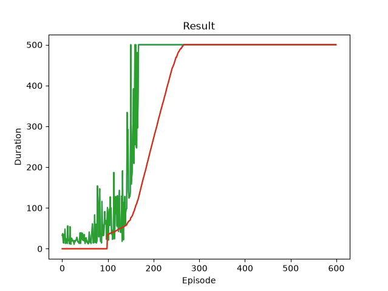

# CartPole DQN

参考 [PyTorch 官方 Reinforcement Learning (DQN) 教程](https://docs.pytorch.org/tutorials/intermediate/reinforcement_q_learning.html)，在 Gymnasium 的 `CartPole-v1` 环境中学习和实践 DQN。保留教程中的经验回放、epsilon-greedy 探索和目标网络软更新流程，并尝试残差 MLP 网络与 `torch.compile`。

目标是理解从环境交互、经验采样到 Q 值更新的完整训练过程。这里使用状态向量作为输入，不使用图像输入。

## 文件

- [`dqn_cartpole.py`](dqn_cartpole.py)：网络、经验池、训练循环与绘图。
- [`Figure_1.png`](Figure_1.png)：已收录的训练曲线截图。
- [`theory/1312.5602v1.pdf`](theory/1312.5602v1.pdf)：DQN 参考论文 *Playing Atari with Deep Reinforcement Learning*。

## 运行

共享环境的构建与 VS Code 连接方式见[仓库 README](../README.md)。依赖由根目录的 `requirements.in` 和 `requirements.lock` 统一管理，包含 PyTorch、Gymnasium Classic Control 和 Matplotlib。

连接开发容器后，在容器终端执行：

```bash
cd /workspace/cartpole-dqn
python dqn_cartpole.py
```

也可以在打开脚本后按 F5，选择“Python: 调试当前文件（容器内）”。

不使用开发容器时，从 **WSL 终端的仓库根目录**执行以下命令，复用共享镜像并启用 GPU 和 WSLg 显示接口：

```bash
docker compose -f compose.yaml -f compose.gpu.yaml -f compose.gui.yaml run --rm \
  -w /workspace/cartpole-dqn runner python dqn_cartpole.py
```

上述 Compose 命令依据当前配置提供，本次文档更新未重新执行完整训练。

脚本优先选择 CUDA，其次 MPS，最后 CPU；两个 Q 网络都调用 `torch.compile(dynamic=True)`。首次运行包含编译开销，具体后端支持和运行性能需在对应设备上验证。

训练过程中显示 Matplotlib 曲线，结束时输出 `Complete`，并保留结果窗口。当前未启用 CartPole 环境画面渲染，因此显示的是曲线窗口，而非小车动画。运行需要可用的图形显示环境。

## 实现

- **环境：** `CartPole-v1`，输入为 4 维状态，输出为向左、向右两个动作的 Q 值。
- **经验回放：** 使用容量为 10,000 的队列，每次随机采样一个 batch 更新网络。
- **动作选择：** epsilon-greedy，探索率按累计环境步数指数衰减。
- **TD 目标：** 使用目标网络的最大 Q 值计算 bootstrap 目标；真正终止时不 bootstrap，达到时间限制而截断时保留下一状态。
- **优化：** Smooth L1 损失、AdamW（`amsgrad=True`）和最大范数为 1.0 的梯度裁剪。
- **目标网络：** 初始化时复制策略网络参数，之后每个环境步进行软更新。

相对于参考教程，当前主要尝试如下调整：

- 将普通 MLP 换成残差 MLP，默认宽度 32、4 个残差块，每个块的隐藏层宽度为 128。
- 每个残差块采用 `RMSNorm → Linear → SiLU → Linear`，并使用初始为 0 的可学习残差缩放参数；输出头采用 `RMSNorm → Linear`。
- 为策略网络与目标网络接入 `torch.compile`。
- 对维度不小于 2 的参数设置 `weight_decay=0.01`，其余参数不做权重衰减。
- 调整学习率、探索率衰减和梯度裁剪方式。

这些调整是学习实验，尚未通过消融实验验证是否优于教程中的网络和配置，也未测量编译带来的实际加速。

## 主要参数

参数直接在脚本中修改，目前没有命令行参数接口。

| 参数 | 当前值 | 含义 |
|---|---|---|
| `NUM_EPISODES` | 600 | 训练回合数 |
| `BATCH_SIZE` | 128 | 每次更新采样的 transition 数 |
| `GAMMA` | 0.99 | 折扣因子 |
| `EPS_START` / `EPS_END` | 0.9 / 0.01 | 初始探索率与衰减下限 |
| `EPS_DECAY` | 2500 | 探索率指数衰减的步数尺度 |
| `TAU` | 0.005 | 目标网络软更新系数 |
| `LR` | 0.0003 | AdamW 学习率 |
| 经验池容量 | 10,000 | 最多保留的 transition 数 |
| `d_model` / `num_blocks` | 32 / 4 | 网络宽度与残差块数 |

## 结果与当前限制



图中横轴为回合编号，纵轴为每回合持续步数；另一条平滑曲线为最近 100 回合的平均值。代码将前 99 个尚不足窗口长度的位置补为 0，这一段不代表真实的零回报。

从已收录的图片可见，该次训练后期的回合时长达到并维持在 500 步。图片没有配套的随机种子、运行元数据或逐回合原始记录，因此仅作为一次训练的可视化结果，不据此判断跨随机种子的稳定性或相对基线的性能提升。

当前脚本：

- 未固定随机种子，也未进行多随机种子评估或独立的贪心策略评估。
- 未保存模型、优化器状态、逐回合数据或 TensorBoard 日志。
- 未自动保存图片；需要通过 Matplotlib 窗口手动保存。重新运行不会自动更新仓库中的 `Figure_1.png`。
- 尚未接入根目录约定的 `runs/` 实验记录结构。

## 参考资料

1. [PyTorch 官方 DQN 教程](https://docs.pytorch.org/tutorials/intermediate/reinforcement_q_learning.html)：本实现的主要学习与代码参考来源。
2. [Mnih et al., Playing Atari with Deep Reinforcement Learning (2013)](https://arxiv.org/abs/1312.5602)：DQN 参考论文，本目录保留了其 v1 PDF。当前项目是状态输入的 CartPole 实验，并非论文 Atari 实验的完整复现。
