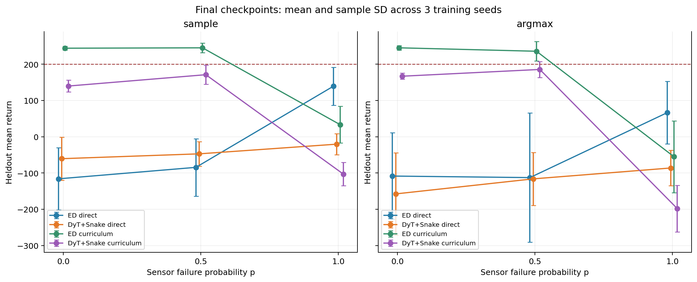
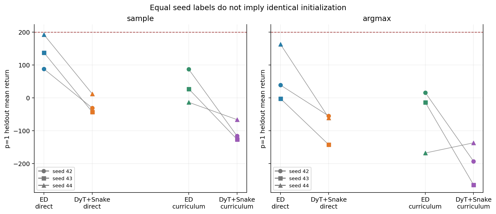
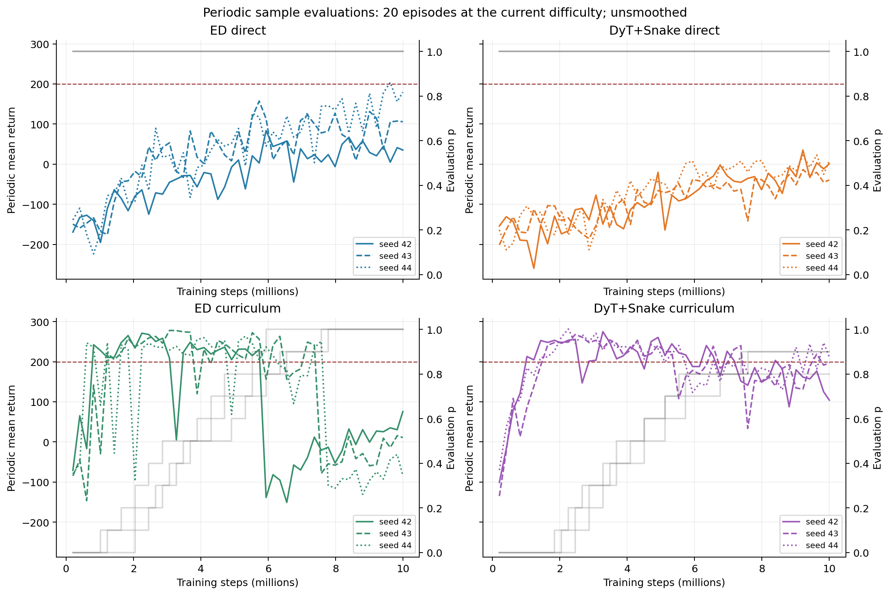
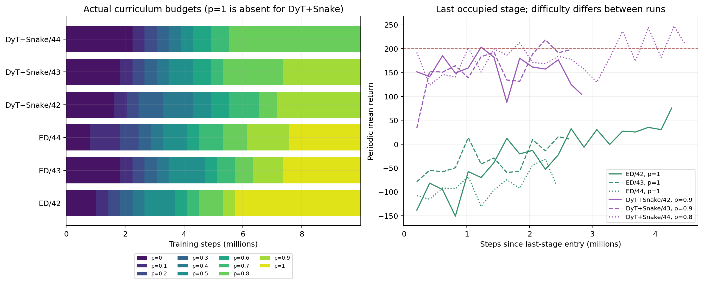
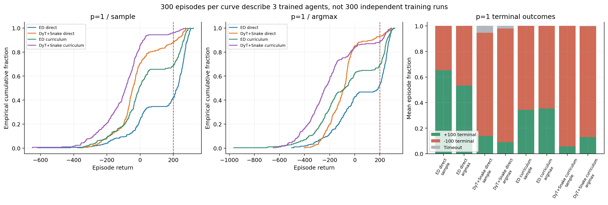
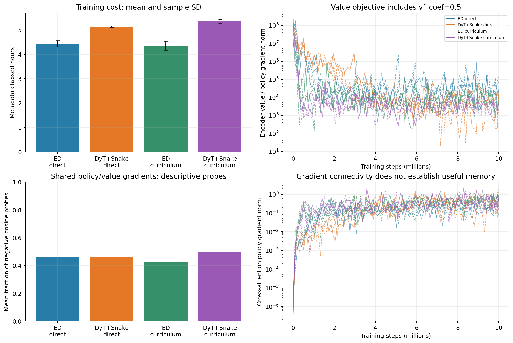

# LunarLander PPO-POMDP：DyT + Snake Encoder–Decoder 实验报告

报告日期：2026-11-16（北京时间）  
新批次：`encoder-decoder-dyt-snake-10m-v1`  
历史对照：`encoder-decoder-10m-v1 / ED_PO01、ED_PO03`  
实验入口：`powershell -NoProfile -ExecutionPolicy Bypass -File .\lunarlander-ppo-pomdp\run_dyt_snake.ps1`

## 1. 主要结论：这次失败告诉了我们什么？

**在本任务、本预算和沿用的 PPO 配方下，把 RMSNorm + SwiGLU 同时替换成 DyT + Swi-Snake-GLU，结果明显变差，现阶段没有支持替换原 Encoder–Decoder 基线的证据。** 但这次实验提供了两类不同的失败证据，值得分别保留：

1. **直接 `p=1` 训练发生了持续的学习退步。** 三个同编号训练种子的最终 sample、argmax 均分全部低于历史 ED_PO01；周期评估也一直较低。这不是只在最终评估出现的一次偶然失分。
2. **成绩课程首先败在推进不足。** 三个种子分别停在 `p=0.9、0.9、0.8`，目标难度 `p=1` 的实际训练预算全部为零。历史 ED_PO03 三个种子均到达 `p=1`。因此，新课程模型在 `p=1` 的成绩反映了未训练到目标条件时的迁移表现，不能解释为“经过相同最终阶段训练后仍然更差”。
3. **较温和的训练诊断没有转化成较好的策略。** 新模型的梯度范数较小、课程组 KL 提前停止更少、样本复用更充分；任务成绩却下降。现有记录没有支持“数值发散导致失败”，也没有支持“这些优化指标更好，所以模型学得更好”。

主指标统一使用最终 `latest.pt` 在 `p=1` 下的评估。下表中的均值与 SD 按三个独立训练种子计算；“≥200”是单回合回报达到 200 的比例。

| 训练方式 / 动作策略 | 历史 RMSNorm + SwiGLU | 新 DyT + Snake | 新减旧 | ≥200 比例：历史 → 新 |
|---|---:|---:|---:|---:|
| 直接训练 / sample | 139.29 ± 52.32 | **−20.52 ± 29.00** | −159.82 | 58.3% → 11.7% |
| 直接训练 / argmax | 66.60 ± 86.14 | **−86.22 ± 48.95** | −152.82 | 47.3% → 7.0% |
| 成绩课程 / sample | 33.43 ± 50.52 | **−103.00 ± 32.09** | −136.44 | 31.3% → 4.0% |
| 成绩课程 / argmax | −55.22 ± 98.81 | **−198.31 ± 64.05** | −143.10 | 30.7% → 11.3% |

这说明**当前组件组合与原配方不适配**。由于 DyT 和 Snake 同时改变、源码也与历史不同，本实验不能判定是哪一个组件造成了退步，更不能推导出它们在其他任务上无效。

## 2. 实验实际改变了什么？

### 2.1 四个分析条件

| 报告简称 | 原始组名 | 训练方案 | 组件 |
|---|---|---|---|
| ED 直接组 | `ED_PO01` | 全程 `p=1` | RMSNorm + SwiGLU，历史 |
| 新直接组 | `DYT_SNAKE_ED_PO01` | 全程 `p=1` | DyT + Swi-Snake-GLU |
| ED 课程组 | `ED_PO03` | 成绩门槛课程 | RMSNorm + SwiGLU，历史 |
| 新课程组 | `DYT_SNAKE_ED_PO03` | 相同成绩门槛课程 | DyT + Swi-Snake-GLU |

每组训练种子为 42、43、44，从随机初始化开始。每次请求 1,000 万环境步，实际执行 **9,998,336 步、4,882 次更新**；新增六次训练共 **59,990,016 步**。

`p` 是 `vx、vy、angle、angular_velocity` 各通道在各环境、各时间步独立缺失的概率。`x、y` 与双腿接触始终可见。缺失读数置零，同时提供可用性标记；输入为 8 维读数、8 维可用性和 4 维上一动作，共 **20 维**。本轮没有加入 XY Fourier，也没有向策略额外提供真实隐藏状态。

共同架构为 D256、Encoder 4 层、Decoder 4 层、4 heads、单层窗口 32，残差门控初始值 `1e-4`。共同 PPO 设置包括：8 环境 × 256 步，学习序列 64，每 minibatch 4 条序列，最多 4 epochs；学习率从 `3e-4` 线性降至 0，优势标准化开启，价值裁剪关闭，`vf_coef=0.5`、固定 `ent_coef=0.01`、全局梯度裁剪 0.5、`target_kl=0.02`。

对旧配置补齐当时省略的默认项后，登记训练配方的有效差异只有 `norm_type` 和 `ffn_type`。默认项、具体差异及各批次来源保存在 [audit.json](dyt-snake-analysis/audit.json)。这只说明**声明的配方相同**，不等于源码完全相同或已完成同期单组件消融。

### 2.2 两项组件改动的含义

本仓库的 DyT 为：

\[
\operatorname{DyT}(x)=\gamma\odot\tanh(\alpha x)+\beta.
\]

每处有独立的可学习标量斜率 `α`，初始为 0.5，以及逐通道仿射参数。它替换了所有启用的 RMSNorm 位置，**包含自注意力和交叉注意力 Q/K，以及交叉注意力 query/memory 的归一化位置**；不只替换 FFN 前的一层。`qk_norm=true`、`final_norm=false` 保持相同。

本仓库的 Swi-Snake-GLU 保留 SiLU gate，在原来线性的 value 分支加入：

\[
\operatorname{Snake}(u)=u+\frac{\sin^2(a\odot u)}{a+\epsilon},\qquad
a=\exp(\mathrm{log\_alpha}),
\]

再计算 `down(SiLU(gate) × Snake(value))`。`a` 按 FFN 通道学习，初值 1，`ε=1e-6`。这是隐层非线性的改变，**不能直接等同于给速度或姿态增加了周期观测信息**。准确实现见 [normalization.py](../../shared/src/rl_shared/layers/normalization.py)、[activations.py](../../shared/src/rl_shared/layers/activations.py) 和 [feedforward.py](../../shared/src/rl_shared/models/transformer/feedforward.py)。

DyT 原论文研究用逐元素 tanh 操作替代 Transformer 归一化；Snake 原论文研究周期函数学习的归纳偏置。这些动机可以支持提出实验，不能替代本任务的验证。本轮结论也只针对上述具体实现与组合。[DyT 原论文](https://arxiv.org/abs/2503.10622)，[Snake 原论文](https://arxiv.org/abs/2006.08195)。

参数量从 **7,489,305 增至 7,504,201**，增加 14,896，约 **0.20%**。策略 / 价值感受野上限仍为 249 / 125 个原始输入时间步；rollout cache 均为 6,291,840 bytes。因此，这轮的主要变化不是扩大模型宽度或历史窗口。

## 3. 数据核验与统计边界

本报告只读原始训练产物，按 `state.json` 的当前 attempt 选择数据；没有重新训练、加载 checkpoint 推理或补充评估。

| 核验项 | 结果 |
|---|---|
| 新批次 | 6 次训练 + 36 次最终评估，**42/42 完成** |
| 历史比较范围 | ED_PO01 / ED_PO03，同为 42 个任务 |
| 当前 attempt | 新旧全部为 attempt 1，未混入烟测 |
| 训练日志 | 共 58,584 行，更新编号及累计步数逐行核验 |
| 周期评估 | 共 588 次、11,760 条回合记录 |
| 最终评估 | 共 72 次、7,200 条回合记录 |
| 逐回合复算 | **18,960 条回合记录、10,044 项数值比较通过** |
| SHA-256 | **306 个登记文件全部一致**，包含最终权重 |
| 评估来源 | 训练 run ID、配置、checkpoint 哈希及依赖关系一致 |
| 新批次运行时间 | 2026-11-14 18:27 至 2026-11-16 01:25，北京时间 |
| 当前训练源码 | 匹配新批次：`f4a4c32b…bd659476` |
| 历史源码 | 按自身批次核验：`a239ed63…481bba3e` |

两批次登记的设备、依赖、精度和协议相同：RTX 4090 Laptop GPU，PyTorch 2.9.1 / CUDA 12.8，Gymnasium 1.2.2；FP32、math SDPA、TF32/AMP 关闭。六次新训练与六次历史训练的 Inductor 编译路径均启用。

周期评估采用当前课程难度，sample、20 回合、环境种子 10000–10019；最终 `latest.pt` 按 `p=0、0.5、1` × sample / argmax，各评估 100 回合、8 环境、环境种子 20000–20099，协议 `batched-policy-v2`。

**主表先按训练种子计算，再对三个训练种子等权平均；SD 为样本标准差，不是置信区间。** 相同训练种子编号不代表初始化和轨迹严格匹配。300 个最终评估回合仍只来自三个训练出的策略；本报告不进行把回合当作独立训练的显著性检验。最终评估种子集已被历史实验使用，因此属于探索性比较。

## 4. 最终权重：退步是否只发生在目标难度？



误差棒是三个训练种子间的样本 SD；连线只引导阅读，中间概率没有实测。200 分虚线仅表示均分要求，完整门槛还包括 ≥200 比例达到 80%。

### 4.1 sample 的完整结果

| 条件 | p=0 均分 ± SD | ≥200 | p=0.5 均分 ± SD | ≥200 | p=1 均分 ± SD | ≥200 |
|---|---:|---:|---:|---:|---:|---:|
| ED 直接组 | −116.13 ± 85.76 | 2.0% | −84.47 ± 79.24 | 4.7% | 139.29 ± 52.32 | 58.3% |
| 新直接组 | −60.57 ± 59.56 | 7.3% | −47.21 ± 33.76 | 4.0% | −20.52 ± 29.00 | 11.7% |
| ED 课程组 | 244.08 ± 5.54 | 90.0% | 245.14 ± 13.03 | 90.3% | 33.43 ± 50.52 | 31.3% |
| 新课程组 | 139.75 ± 16.33 | 52.7% | 171.02 ± 26.10 | 64.3% | −103.00 ± 32.09 | 4.0% |

新直接组在 `p=0、0.5` 的 sample 均分分别比历史高 55.56、37.26 分，但仍为负，且各条件只有两个同编号种子涨分。这是局部改善，不能抵消目标条件下降约 160 分、≥200 比例下降 46.7 个百分点。

新课程组在 `p=0、0.5` 仍有一定能力，但均分分别下降 **104.32、74.12 分**，三个种子的 sample 比较均下降。也就是说，问题不只发生在从未训练过的 `p=1`；最终权重在较低缺失条件下也明显弱于历史。这些分数只能描述最终能力，无法单凭最终评估区分“早期学得较弱”和“后期遗忘”。

### 4.2 argmax 的完整结果

| 条件 | p=0 均分 ± SD | ≥200 | p=0.5 均分 ± SD | ≥200 | p=1 均分 ± SD | ≥200 |
|---|---:|---:|---:|---:|---:|---:|
| ED 直接组 | −108.50 ± 119.22 | 4.7% | −112.74 ± 177.99 | 11.0% | 66.60 ± 86.14 | 47.3% |
| 新直接组 | −157.70 ± 113.64 | 4.0% | −116.23 ± 72.88 | 3.0% | −86.22 ± 48.95 | 7.0% |
| ED 课程组 | 245.17 ± 6.15 | 95.0% | 235.67 ± 26.60 | 85.3% | −55.22 ± 98.81 | 30.7% |
| 新课程组 | 166.88 ± 8.38 | 66.7% | 185.51 ± 21.88 | 71.3% | −198.31 ± 64.05 | 11.3% |

新课程模型在 `p=0、0.5` 下 argmax 高于 sample；到了 `p=1`，关系反转，argmax 比 sample **低 95.31 分**。新直接组在 `p=1` 下 argmax 也低 65.69 分。**切换成确定性动作选择不能修复目标任务表现。** sample 与 argmax 会访问不同状态，仅凭均分差不能断言随机动作的具体控制作用。

## 5. 种子差异：是否只是某一次训练拖低均值？



图中连接相同训练种子编号，用于描述变化，不表示严格配对的随机初始化。

| 种子 | ED 直接 / sample | 新直接 / sample | 变化 | ED 课程 / sample | 新课程 / sample | 变化 |
|---|---:|---:|---:|---:|---:|---:|
| 42 | 87.78 | −30.92 | −118.70 | 86.79 | −116.20 | −202.99 |
| 43 | 137.72 | −42.89 | −180.61 | 27.18 | −126.39 | −153.57 |
| 44 | 192.38 | 12.24 | −180.14 | −13.67 | −66.42 | −52.75 |

直接组 sample 三次全部下降；逐一去掉一个种子后，剩余两次的平均变化仍为 **−180.38 至 −149.42 分**。课程组 sample 同样三次全部下降，去掉任一种子仍为 **−178.28 至 −103.16 分**。因此，在现有三个种子的描述范围内，负面方向不是由一个异常种子独自造成。

argmax 直接组三次也全部下降。课程组 argmax 有一个例外：seed 44 从 −168.03 改善至 −136.98，增加 31.05 分，但另外两个种子下降约 209、251 分；去掉任一种子的平均变化仍为负。完整数据见 [逐种子差值](dyt-snake-analysis/seed-differences.csv) 与 [差值敏感性汇总](dyt-snake-analysis/difference-groups.csv)。

这些结果足以支持“本轮组合实验明显退步”，三个种子仍不足以给出组件效应的精确总体估计。

## 6. 学习过程：直接组学不起来，课程组走不到终点



每条彩色曲线为一个训练种子的未平滑周期均分；灰线为右轴的评估 `p`。课程曲线处于不同难度，不能用全程均分或曲线面积直接排名。

### 6.1 直接组的退步贯穿周期评估

新直接组三个种子的最佳周期均分分别仅为 **35.16、−13.59、23.01**；历史分别为 **83.66、157.34、203.94**。新增运行没有一次 `p=1` 周期评估同时满足均分 ≥200 和 ≥200 比例 ≥80%，六次新训练的 `final_task_solved` 均为 false。

最终 100 回合评估与周期 20 回合评估本就不必相同。但这里两类记录给出的方向一致：直接组的差距在训练过程中已经存在。主表仍使用预先约定的最终权重，没有挑选周期峰值替代最终结果。

### 6.2 课程的真正瓶颈在 `p=0.8–0.9`

课程从 `p=0` 开始，每 100 次更新评估一次；连续两次评估同时满足均分 ≥200、≥200 比例 ≥80%，才增加 `p` 0.1，且不回退。



左图按训练日志重算各阶段环境步数；右图按进入最后停留阶段后的步数对齐。**右图新旧曲线的难度不同**：历史为 `p=1`，新模型为 `p=0.8` 或 `0.9`，不能把新曲线更高解释为优于历史。

| 新课程种子 | 最终 p | 进入该阶段：百万步 | 该阶段训练：百万步 | 进入时学习率 | 该阶段评估次数 / 单次达标次数 | 最后 5 次均分 / ≥200 比例 |
|---|---:|---:|---:|---:|---:|---:|
| 42 | 0.9 | 7.168 | 2.830 | 8.49e−5 | 14 / 0 | 144.97 / 57.0% |
| 43 | 0.9 | 7.373 | 2.626 | 7.87e−5 | 13 / 1 | 185.54 / 69.0% |
| 44 | 0.8 | 5.530 | 4.469 | 1.34e−4 | 22 / 3 | 211.85 / 76.0% |

seed 44 有三次单次达标，但没有连续两次达标，所以没有晋级；最后五次平均回报超过 200，≥200 比例仍仅 76%。seed 42 在 `p=0.9` 的最佳均分达到 203.25，但没有一次同时满足两个门槛。**只看均分越过 200 会误判课程为何停滞。**

历史三个种子进入 `p=1` 的累计步数为 5.734、7.373、7.578 百万步，分别获得 4.264、2.626、2.421 百万步最终阶段训练。新模型并非预算耗尽时刚接触瓶颈：它们已在最后阶段停留约 **26%–45%** 的全部环境步。

线性学习率继续随总预算下降，可能限制了后期适应；但这只是候选解释。当前既没有重置学习率的对照，也没有延长最后阶段的实验，不能据此保证继续训练就会通过门槛。

### 6.3 `p=0.9` 与 `p=1` 不是同一种观测条件

`p=0.9` 时，每个目标传感器仍有 10% 的时间可见；`p=1` 时，四个目标传感器全程不可见。根据这里独立逐步缺失的定义，单个传感器在 32 步内至少可见一次的概率，在 `p=0.9` 时为 `1−0.9^32 ≈ 96.6%`，在 `p=1` 时为零。这是观测过程的概率计算，不是对模型已使用历史的测量。

因此，高缺失课程中仍可能利用偶尔出现的直接测量；到 `p=1` 则必须完全依赖剩余观测与历史。新课程模型的 `p=1` 测试正跨越了这个边界。其成绩不能直接估计“已经适应完全缺失后”的上限。另一方面，新直接组全程在 `p=1` 训练仍然很弱，说明**课程没有推进成功不是整轮失败的唯一解释**。

## 7. 失败回合：主要是负终止，而非普遍超时



前两图汇集每个条件 300 回合，只描述分布；它们仍来自三个训练种子。下表的“+100 / −100 终止”按环境最后一步奖励分类，**不与 ≥200 比例混用**。−100 可能包含不同失败原因，现有统计不把它全部标成某一种坠毁。

| p=1 条件 | +100 终止 | −100 终止 | 超时 | 平均回合长度 | 回报 <−300 |
|---|---:|---:|---:|---:|---:|
| ED 直接 / sample | 65.3% | 34.7% | 0.0% | 212.81 | 1.3% |
| 新直接 / sample | 14.0% | **80.7%** | 5.3% | 179.14 | 1.3% |
| ED 直接 / argmax | 53.3% | 46.7% | 0.0% | 208.54 | 5.7% |
| 新直接 / argmax | 9.0% | **89.0%** | 2.0% | 154.31 | 3.0% |
| ED 课程 / sample | 34.3% | 65.7% | 0.0% | 157.50 | 3.0% |
| 新课程 / sample | 5.7% | **94.3%** | 0.0% | 118.05 | 8.3% |
| ED 课程 / argmax | 35.3% | 64.7% | 0.0% | 199.52 | 15.3% |
| 新课程 / argmax | 13.0% | **86.7%** | 0.3% | 164.14 | **34.7%** |

**直接组主要丢失了高回报与正终止回合。** sample 的极低回报比例没有明显增加，但 +100 终止比例从 65.3% 降至 14.0%。这与“均值只是被少数特别差的回合拉低”不同。seed 43 还出现 15% 的 sample 超时，是一个特定种子的补充失败模式，不宜推广为所有模型的主要问题。

**课程组在目标条件下更常快速负终止。** sample 平均回合长度降至 118 步，94.3% 为 −100 终止；argmax 则有更重的低回报尾部，34.7% 的回合低于 −300。argmax 的 ≥200 比例虽然高于 sample，均分反而低约 95 分，说明只统计高分比例会漏掉失败回合代价。

新课程组 `p=1` 的主发动机动作占比为 sample **42.3%**、argmax **49.5%**，历史为 35.2%、39.2%。这是行为变化，尚不能说明“发动机使用过多导致失败”：缺少逐步状态—动作轨迹和干预实验，因果顺序未知。

## 8. 训练诊断：哪些解释有证据，哪些没有？



### 8.1 没有记录到数值发散或回放不一致

新增六次训练的关键损失、梯度与熵记录均为有限数；训练完成，缓存回放一致性告警为 **0**，最大 log-probability 误差为 **1.53e−5**，低于告警阈值 `1e−4`。登记产物哈希与评估来源也一致。

这些结果降低了“非有限数值或 rollout/replay 概率失配解释此次退步”的可能性，但**不构成实现绝对正确的证明**，也不检查未记录的中间激活。

### 8.2 更充分的 PPO 更新不等于更好学习

| 指标：先按单次训练计算，再跨种子平均 | ED 直接 | 新直接 | ED 课程 | 新课程 |
|---|---:|---:|---:|---:|
| KL 提前停止更新比例 | 1.93% | 2.44% | 18.70% | 4.83% |
| 平均样本复用次数，上限 4 | 3.964 | 3.969 | 3.585 | 3.910 |
| 独特样本覆盖率 | 99.86% | 99.96% | 97.11% | 99.68% |
| 最后 500 次更新 explained variance | 0.780 | 0.798 | 0.805 | 0.761 |
| 最后 500 次更新 value loss | 221.56 | 192.71 | 275.86 | 130.81 |
| 最后 500 次更新行为熵，nats | 0.496 | 0.655 | 0.533 | 0.482 |

新课程组更少触发 KL 提前停止，因而接近用满四轮数据，却没有更好的成绩。其较小 value loss 还受到课程难度和回报目标分布不同的影响；新旧课程在末期分别处于 `p=0.8/0.9` 与 `p=1`，不能把 loss 降低当作同一任务上的价值估计改善。直接组同样说明 explained variance 较高也不足以保证控制有效。

### 8.3 梯度变小，但共享价值梯度仍值得检查

最后 500 次更新中，先求每次训练的裁剪前全局梯度范数中位数，再跨种子平均：直接组由约 **43,598 降至 10,915**，课程组由约 **22,810 降至 1,660**。然而四组几乎所有优化步骤仍触发阈值 0.5 的全局裁剪。这不支持“新模型只是出现更大的梯度爆炸”的解释；较小范数也没有带来更高回报。

每次训练有 99 个固定批次梯度探针，新模型共 594 个。单种子 Encoder 价值 / 策略梯度范数比的中位数，新直接组约 **9,136–10,922**，新课程组约 **2,623–4,002**，均低于对应历史组，但仍很大。探针价值目标已包含 `vf_coef=0.5`；探针不等同于完整 rollout，更不等同于 Adam 实际参数更新贡献。

共享参数上两类梯度余弦为负的探针比例，跨种子平均为：历史直接 **46.5%**、新直接 **45.8%**，历史课程 **42.4%**、新课程 **49.5%**。直接组没有更高的冲突频率却退步明显，故“冲突频率升高”也不足以单独解释结果。

Encoder 的策略梯度、价值梯度以及 cross-attention 策略梯度在所有探针上均非零且有限，交叉残差门控也发生变化。这说明路径连通，**不能证明模型有效利用了 Encoder memory**。同样，没有保存 DyT 饱和率、学习到的斜率分布或 Snake 相位分布，所以不能把“tanh 饱和”或“频率失控”写成已经查明的原因。

## 9. 代价：没有观察到这套组合的实际效率优势

| 指标，三种子均值 | ED 直接 | 新直接 | ED 课程 | 新课程 |
|---|---:|---:|---:|---:|
| 训练元数据 elapsed，小时 ± SD | 4.43 ± 0.13 | 5.13 ± 0.03 | 4.35 ± 0.18 | 5.34 ± 0.08 |
| attempt 起止时钟差，小时 | 4.79 | 5.07 | 4.56 | 5.15 |
| 日志 collect 时间之和，小时 | 2.71 | 3.06 | 2.73 | 3.24 |
| 日志 PPO 时间之和，小时 | 1.11 | 1.38 | 1.02 | 1.44 |
| PyTorch 峰值 allocated，MiB | 662.0 | 805.2 | 661.6 | 805.6 |

按训练元数据，新直接组和新课程组耗时分别增加 **15.8%、22.8%**；按 attempt 起止时钟差，则增加 **5.7%、12.9%**。峰值 allocated 均增加约 **22%**，而参数量只增加 0.20%。额外代价不能简单归因于参数存储，具体来源仍需算子级 profiling；课程组还存在优化步骤数量及状态分布不同的影响。

**计时字段存在实际不一致，应保留限制。** 新训练元数据 elapsed 合计为 31.41 小时，而新批次全部 42 个任务的 attempt 起止时钟差合计为 30.98 小时。前者使用训练进程 `perf_counter`，后者来自外部任务时间戳；当前产物不足以确定差异原因。因此，报告分别列出，不能混加，也不把它们视作精确 GPU 小时或严格的组件加速比。这里只能说：两种计时口径均未显示本轮组合更快。

## 10. 如何解释，以及下一步先验证什么？

### 10.1 现有数据支持的判断

| 判断 | 证据与边界 |
|---|---|
| 本轮组合在目标任务上退步 | 直接组两种动作策略、三个种子全降；sample 的两组全部种子下降 |
| 课程推进也是失败的一部分 | 新课程目标阶段训练步数全为零，历史全部进入目标阶段 |
| 不能只归因于课程预算 | 新直接组具有完整 `p=1` 预算，同样明显下降 |
| 不能只归因于少数极差回合 | 新直接组主要是正终止和高回报回合大量减少 |
| 不能用数值指标代替成绩 | 未记录到非有限数值；范数变小、复用增加仍然退步 |
| 不能归因于单一组件 | DyT 与 Snake 同时改变，历史源码不同，缺少独立组件实验 |

从实现可以提出两个具体机制假设。其一，DyT 在小输入附近近似线性缩放，在大输入处发生压缩；RMSNorm 则依据当前向量 RMS 调整尺度。替换 Q/K 等多个位置后，注意力输入尺度和 logits 分布可能改变。其二，Snake 的周期残差改变 value 分支的均值、曲率和 gate 乘积的分布。这些变化可能需要不同的初始化或优化参数。**这两项都是从公式推导的候选机制，当前日志没有直接测到。**

### 10.2 优先级一：先拆分 DyT 与 Snake

最有信息量的下一轮是同一份源码、相同预算的 2×2 组件实验：

| 条件 | norm_type | ffn_type | 回答的问题 |
|---|---|---|---|
| 同期基线 | rmsnorm | swiglu | 当前实现能否复现历史基线量级 |
| DyT-only | dyt | swiglu | 只换归一化是否退步 |
| Snake-only | rmsnorm | swi_snake_glu | 只换 value 非线性是否退步 |
| 组合 | dyt | swi_snake_glu | 是否存在组合交互 |

**先用直接 `p=1` 训练比较**，以免组件差异同时改变课程路径和目标阶段预算。短程运行可以检查功能与学习趋势，最终判断仍应使用相同完整预算、多个训练种子和统一最终评估；不能只比较最好的短程曲线。课程对照放在组件信号明确之后。

这轮可沿用已有结果做探索；需要确认新结论时，应另行预留未用于选择方案的最终评估种子。这里列的是后续实验建议，本报告没有启动这些运行。

### 10.3 优先级二：记录能够检验假设的中间量

若继续研究 DyT，按 Encoder / Decoder、self / cross、Q / K / FFN 前等位置，保存输入 RMS、`α` 与仿射参数分布、`|αx|>2` 的比例，以及 Q/K 范数、attention logits 与 attention entropy。这样才能检验“压缩或注意力尺度改变”，而非看低回报后倒推饱和。

若继续研究 Snake，保存通道频率分布、value 分支激活 RMS、周期残差相对线性项的大小及其梯度。若 DyT-only 已显示问题，再比较“仅替换块前归一化”和“连 Q/K 也替换”，以定位替换位置；不要一开始同时更改熵、学习率、梯度裁剪和全部归一化位置。

### 10.4 优先级三：把课程推进与最终阶段适应分开

针对当前瓶颈，可以设计单独对照：在固定步数切换到 `p=1`，为所有条件保留相同目标阶段预算；再独立比较是否重启学习率。另一种问题是间歇读数依赖，可在最终权重上补测 `p=0.8、0.9、0.95、0.99、1` 的性能曲线。

这些补测各自回答不同问题：前者检验课程预算及后期适应，后者定位从偶发可见到完全不可见的性能边界。**当前只有周期评估的 `p=0.8/0.9` 和最终固定网格结果，不能把中间概率曲线写成已有观测。**

本轮最有用的产出，是把下一步的问题缩小到了可检验的范围：先确认独立组件与替换位置，再处理课程与目标阶段预算。现有结果支持保留 RMSNorm + SwiGLU 作为比较基线，不支持直接扩大这套组合的训练预算并预期自然恢复。

## 11. 复现与数据索引

从仓库根目录运行：

```powershell
python -B lunarlander-ppo-pomdp/reports/scripts/analyze_dyt_snake.py
```

脚本依赖 NumPy、Pandas、Matplotlib，复用同目录的既有统计函数；只读取 JSON / CSV 与权重文件哈希，不反序列化权重、不导入训练模块，不向 `runs/` 写入。它会重建分析 CSV、核验 JSON、结果表与六张图，不覆盖本文。

- [复现说明与字段定义](dyt-snake-analysis/README.md)
- [核验摘要](dyt-snake-analysis/audit.json) / [文件哈希清单](dyt-snake-analysis/artifact-audit.csv)
- [最终评估：单种子](dyt-snake-analysis/heldout-seeds.csv) / [跨种子](dyt-snake-analysis/heldout-groups.csv) / [逐回合](dyt-snake-analysis/heldout-episodes.csv)
- [训练汇总](dyt-snake-analysis/training-seeds.csv) / [周期评估](dyt-snake-analysis/periodic-evaluations.csv) / [梯度探针](dyt-snake-analysis/diagnostics.csv)
- [实际课程预算](dyt-snake-analysis/performance-stages.csv) / [分阶段评估](dyt-snake-analysis/stage-evaluations.csv) / [课程转换](dyt-snake-analysis/transitions.csv)
- [历史 Encoder–Decoder 报告](ED_PO01-ED_PO03-encoder-decoder-analysis.md)
