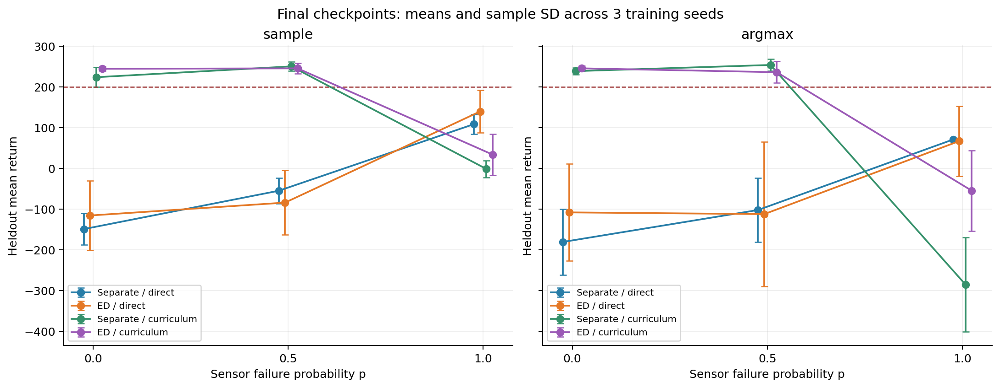
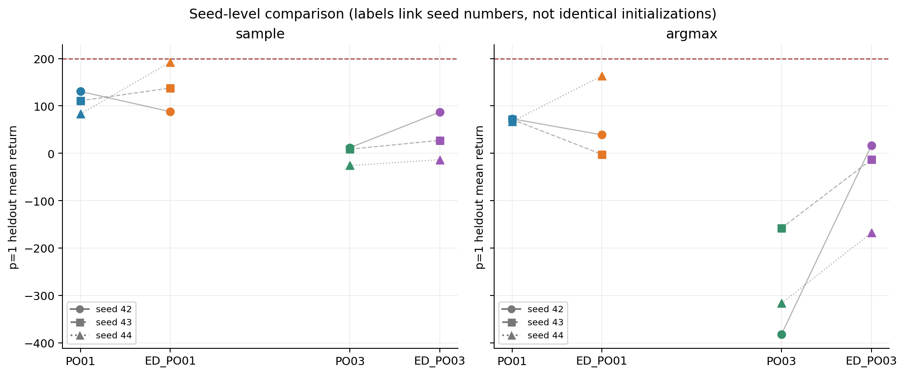
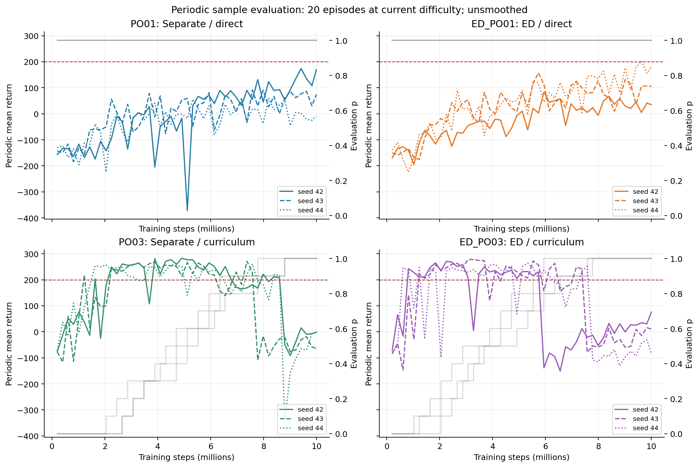
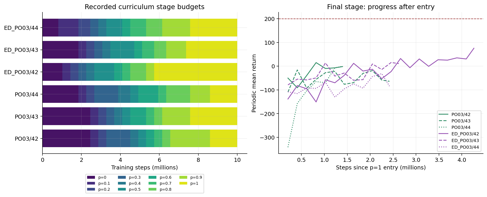
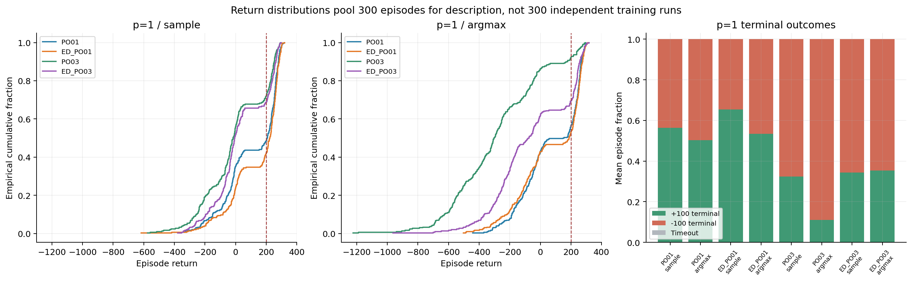
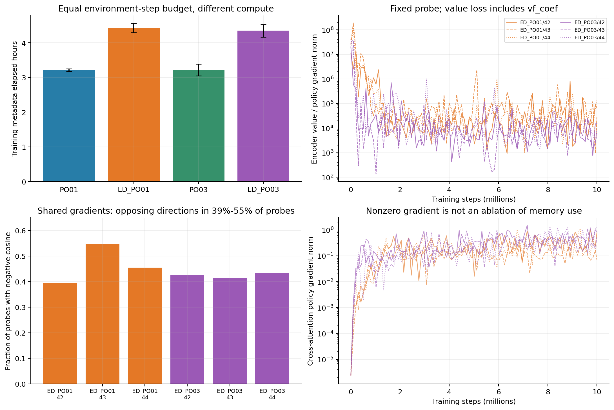

# LunarLander PPO-POMDP：Encoder–Decoder 探索实验报告

报告日期：2026-11-12（北京时间）  
新批次：`encoder-decoder-10m-v1`；历史对照：`course-10m-v1 / PO01、PO03`  
实验入口：`powershell -NoProfile -ExecutionPolicy Bypass -File .\lunarlander-ppo-pomdp\run_encoder_decoder.ps1`

## 1. 有没有提升？

**有局部改善，但还不能说 Encoder–Decoder 已经稳定优于原架构，更没有解决最终部分观测任务。** 直接训练组的 sample 均分有所提高，课程组主要缓解了原先 argmax 下的严重退化；代价是约 35%–38% 的训练耗时增加。当前结果值得继续做小规模验证，尚不足以替换原基线或直接扩大训练预算。

以下是最重要的比较：同为最终 `latest.pt`，在四个目标传感器持续缺失的 `p=1` 下评估。均分为三个训练种子的均值 ± 样本标准差；“≥200”是单回合回报达到 200 的比例。

| 训练方案 | 历史均分 | Encoder–Decoder 均分 | 均分变化 | ≥200 比例：历史 → 新 |
|---|---:|---:|---:|---:|
| 直接训练 / sample | 108.11 ± 23.83 | **139.29 ± 52.32** | +31.19 | 51.7% → **58.3%** |
| 直接训练 / argmax | **70.40 ± 3.08** | 66.60 ± 86.14 | −3.80 | 44.0% → 47.3% |
| 成绩课程 / sample | −1.83 ± 20.96 | **33.43 ± 50.52** | +35.27 | 28.0% → 31.3% |
| 成绩课程 / argmax | −285.78 ± 115.35 | **−55.22 ± 98.81** | +230.56 | 7.7% → **30.7%** |

这张表需要结合三个限制理解：

- **直接训练的改善不稳定。** sample 的同编号种子变化分别为 −42.66、+26.84、+109.37 分；去掉 seed 44 后，剩余两次比较平均为 **−7.91 分**。argmax 下只有一个种子的均分提高。
- **课程组均分改善更一致，但最终难度训练预算也增加了。** 三个种子的 sample、argmax 均分都提高；新模型更早通过课程，在 `p=1` 下平均训练 310.34 万步，历史模型为 173.81 万步。因此这些改善包含课程轨迹改变带来的收益。
- **最终任务仍未达标。** 六次新增训练的 `final_task_solved` 全为 false；新模型中最好的单个最终权重在 `p=1/sample` 下为 192.38 分、71% 的 ≥200 比例，仍未同时达到均分 200 和比例 80% 的要求。

## 2. 实验设计与核验

### 2.1 比较范围

| 条件 | 架构 | 训练观测方案 | 来源 |
|---|---|---|---|
| PO01 | 独立 Actor / Critic Transformer | 全程 `p=1` | 历史第二阶段 |
| ED_PO01 | Encoder–Decoder | 全程 `p=1` | 本批次 |
| PO03 | 独立 Actor / Critic Transformer | 成绩门槛课程 | 历史第二阶段 |
| ED_PO03 | Encoder–Decoder | 相同成绩门槛课程 | 本批次 |

各组训练种子为 42、43、44，从随机初始化开始；每次请求 1,000 万环境步，实际完成 **9,998,336 步、4,882 次 PPO 更新**。课程从 `p=0` 开始，连续两次周期评估同时满足均分 ≥200、≥200 比例 ≥80%，才将 `p` 增加 0.1；不回退。

`p` 表示 `vx、vy、angle、angular_velocity` 各通道、各环境、各时间步独立缺失的概率。`x、y` 和双腿接触始终可见。缺失读数置零，同时提供可用性标记。模型输入仍为 **8 维读数 + 8 维可用性 + 4 维上一动作，共 20 维**。没有额外提供真实隐藏状态。

对应新旧训练记录的配置逐项比较后，差异仅为 `backbone_mode` 和新增的 `decoder_layers=4`。共同设置包括 D256、4 heads、单层窗口 32，8 环境 × 256 步、学习序列 64、每 minibatch 4 条序列、最多 4 epochs；学习率从 `3e-4` 线性降至 0，优势标准化开启、价值裁剪关闭、熵系数固定 `0.01`、`target_kl=0.02`。

新架构使用独立的 Encoder / Decoder 输入投影；Critic 从 Encoder 读取特征，Actor 经 Decoder 的自注意力和交叉注意力读取历史。策略损失可以回传 Encoder。**这同时改变了容量、策略感受野和策略/价值梯度共享，不能把结果单独解释成 Cross-Attention 的作用。**

| 模型属性 | 历史独立骨干 | Encoder–Decoder |
|---|---:|---:|
| 总参数 | 6,438,677 | 7,489,305（+16.3%） |
| 策略/价值共享参数 | 0 | 3,218,696 |
| 策略最大原始输入感受野 | 125 | 249 |
| 价值最大原始输入感受野 | 125 | 125 |

感受野是架构允许使用的上限，不代表模型已有效利用这么长的历史。Decoder 自身也有历史通路。架构和工程验收细节见 [项目说明](../README.md#encoderdecoder-独立探索实验) 与 [VALIDATION](../VALIDATION.md)。

### 2.2 评估与统计口径

最终权重统一在 `p=0、0.5、1` × sample / argmax 下评估，每个条件 100 回合、8 环境、环境回合种子 20000–20099，协议为 `batched-policy-v2`。sample 按策略分布抽样动作，argmax 选择概率最高的动作。周期评估使用 seed 10000–10019、20 回合，难度随当前课程变化。

所有主要统计均**先在单个训练种子内计算，再对三个训练种子等权汇总**；SD 不是置信区间，300 个评估回合不能作为 300 次独立训练。相同种子编号只用于展示结果变化；不同架构消耗随机数的方式不同，不代表初始化和训练轨迹严格匹配。去掉一个种子的敏感性分析也只是描述性检查。

评估种子集已用于历史分析，本轮属于探索性比较。新旧运行的依赖、硬件与评估协议一致，但源码指纹不同，历史结果保持独立来源，不能当作同期、等容量的单组件消融。

### 2.3 数据完整性

分析从 `state.json` 的当前 attempt 读取产物，未混入烟测或旧尝试。

| 核验项 | 结果 |
|---|---|
| 新批次任务 | 6 次训练 + 36 次最终评估，**42/42 完成**，均为 attempt 1 |
| 历史对照 | 6 次训练 + 36 次最终评估，来自 PO01 / PO03 |
| 新训练总步数 | **59,990,016** |
| 训练日志 | 比较共 58,584 行，更新编号与步数逐行一致 |
| 周期评估 | 新旧共 588 次、11,760 条回合记录 |
| 最终评估 | 新旧共 72 次、7,200 条回合记录 |
| 逐回合复算 | 共 **18,960 条记录、10,044 项数值比较通过** |
| SHA-256 | **306 个唯一登记文件全部一致**，包含最终权重 |
| 来源 | 评估对应的训练 run ID、配置及 checkpoint 哈希一致 |
| 新批次时间范围 | 2026-11-11 09:34 至 2026-11-12 13:58（北京时间） |
| 当前训练源码 | 与新批次指纹一致：`a239ed63…481bba3e` |

历史源码指纹为 `47786bd7…271f179`，按其自身批次核验。完整结果见 [audit.json](encoder-decoder-analysis/audit.json) 和 [文件清单](encoder-decoder-analysis/artifact-audit.csv)。本次只读已有训练产物，没有重训、加载权重做推理或补充评估；新增内容均在 `reports/`。

## 3. 最终权重：提升集中在哪里？



误差棒为三个训练种子间的样本 SD。连线仅引导阅读，中间概率没有实测。图中的 200 分虚线只表示均分要求，不能替代 ≥200 比例要求。

### 3.1 sample 的完整结果

| 条件 | p=0 均分 ± SD | ≥200 | p=0.5 均分 ± SD | ≥200 | p=1 均分 ± SD | ≥200 |
|---|---:|---:|---:|---:|---:|---:|
| PO01 | −149.53 ± 38.47 | 2.0% | −55.31 ± 31.32 | 12.0% | 108.11 ± 23.83 | 51.7% |
| ED_PO01 | −116.13 ± 85.76 | 2.0% | −84.47 ± 79.24 | 4.7% | **139.29 ± 52.32** | **58.3%** |
| PO03 | 223.38 ± 24.05 | 73.7% | **249.99 ± 10.88** | **93.0%** | −1.83 ± 20.96 | 28.0% |
| ED_PO03 | **244.08 ± 5.54** | **90.0%** | 245.14 ± 13.03 | 90.3% | 33.43 ± 50.52 | 31.3% |

**直接训练组仍然偏向自己的训练分布。** ED_PO01 在 `p=1` 下最好，恢复部分或全部传感器后成绩仍为负；`p=0.5` 相比历史 PO01 还下降 29.15 分。输入及可用性模式改变属于分布变化，不能解释成“更多真实信息本身有害”。

**课程组保留了低缺失条件下的能力，但不是全线提高。** ED_PO03 在 `p=0` 的 sample 均分提高 20.69 分，≥200 比例提高 16.3 个百分点；`p=0.5` 均分下降 4.85 分，三个同编号种子都小幅下降。新课程模型仍适合间歇缺失，但原先约 250 分的表现没有进一步提高。

### 3.2 argmax 的完整结果

| 条件 | p=0 均分 ± SD | ≥200 | p=0.5 均分 ± SD | ≥200 | p=1 均分 ± SD | ≥200 |
|---|---:|---:|---:|---:|---:|---:|
| PO01 | −181.02 ± 80.81 | 2.0% | −102.64 ± 78.93 | 14.3% | **70.40 ± 3.08** | 44.0% |
| ED_PO01 | −108.50 ± 119.22 | 4.7% | −112.74 ± 177.99 | 11.0% | 66.60 ± 86.14 | **47.3%** |
| PO03 | 238.30 ± 8.05 | 88.0% | **253.44 ± 14.81** | **95.3%** | −285.78 ± 115.35 | 7.7% |
| ED_PO03 | **245.17 ± 6.15** | **95.0%** | 235.67 ± 26.60 | 85.3% | −55.22 ± 98.81 | 30.7% |

ED_PO03 的 `p=1/argmax` 从很差的历史结果大幅恢复，但均分仍为负，且低于 PO01 的 70.40 分。这是**缓解课程模型的退化**，尚不能叫确定性控制已经可靠。它在 `p=0.5/argmax` 下还下降了 17.77 分、10.0 个百分点的 ≥200 比例。

## 4. 种子差异：平均涨分是否站得住？



图中连线连接相同训练种子编号。完整数值可见 [逐种子差值](encoder-decoder-analysis/seed-differences.csv)。

| 种子 | PO01 sample | ED_PO01 sample | 变化 | PO03 sample | ED_PO03 sample | 变化 |
|---|---:|---:|---:|---:|---:|---:|
| 42 | 130.43 | 87.78 | −42.66 | 11.77 | 86.79 | +75.02 |
| 43 | 110.88 | 137.72 | +26.84 | 8.70 | 27.18 | +18.48 |
| 44 | 83.01 | 192.38 | +109.37 | −25.96 | −13.67 | +12.30 |

ED_PO01 的 sample 均分 SD 从 23.83 增至 52.32，argmax 的 SD 从 3.08 增至 86.14。逐一去掉一个训练种子，直接组 sample 的平均提升范围为 **−7.91 到 +68.11 分**，方向并不稳健。当前更适合表述为“出现了更好的训练结果，平均值也提高了”，而非“通常都能提高约 31 分”。

课程组的 sample 均分提升在三次比较中方向一致，去掉任一种子仍提高 **15.39–46.75 分**；argmax 三次都提高 **144.42–398.31 分**。这一信号比直接组清楚。不过 seed 44 的 ≥200 比例从 26% 降到 16%，说明**均分提高不等于高分回合变多**。三次训练也不足以支撑强显著性或广泛泛化结论。

## 5. 学习过程：最终任务的断崖仍然存在



每条曲线是一个训练种子的未平滑周期均分；灰线为右轴的评估 `p`。课程曲线在同一步数上可能处于不同难度，不能用全程均分或曲线面积直接给架构排名。

ED_PO01 的 seed 44 曾在 update 4700 达到周期均分 **203.94**，但 ≥200 比例只有 **70%**，且并未连续达标。其余新增运行也没有任何一个 `p=1` 周期评估同时满足两个要求。最终留出成绩与训练期间的偶发峰值应分开看，主表统一使用预定的最终权重。

### 5.1 新课程更早推进，最终阶段获得更多预算



| 种子 | 历史进入 p=1：百万步 | 新进入 p=1：百万步 | 历史 p=1 训练：百万步 | 新 p=1 训练：百万步 | 进入时学习率：历史 → 新 |
|---|---:|---:|---:|---:|---:|
| 42 | 8.602 | 5.734 | 1.397 | 4.264 | 4.19e−5 → 1.28e−4 |
| 43 | 7.578 | 7.373 | 2.421 | 2.626 | 7.26e−5 → 7.87e−5 |
| 44 | 8.602 | 7.578 | 1.397 | 2.421 | 4.19e−5 → 7.26e−5 |

新课程三个种子都更早进入最终阶段。其中 seed 42 比历史早 **286.72 万步**，多获得两倍以上的 `p=1` 训练步数，也是课程 sample 涨幅最大的种子。

跨种子平均，最终阶段步数增加约 **78.6%**；`p=1` rollout 的名义学习率之和占全程比例，从 **3.25% 增至 10.31%**。该比例只描述学习率预算，不是实际梯度或参数改变量。**更快通过较简单阶段是整套方法的实际收益，但若要识别架构在同等最终任务训练下的收益，仍需控制课程和学习率轨迹。**

### 5.2 从 p=0.9 到 p=1，三个新种子仍然一起失分

| ED_PO03 种子 | p=0.9 最后一次门槛均分 | 下一次 p=1 均分 | 变化 | 最终 p=1 留出 sample |
|---|---:|---:|---:|---:|
| 42 | 230.61 | −138.35 | −368.96 | 86.79 |
| 43 | 241.37 | −78.74 | −320.11 | 27.18 |
| 44 | 251.10 | −107.96 | −359.06 | −13.67 |

切换前的连续两次门槛均已核验。下一次评估发生在后续 100 次更新之后，因此不是同一权重的即时切换实验。可以确认的是：**新架构依然没有把 p=0.9 的高分表现直接带到 p=1**，随后虽有恢复，仍远低于门槛。

一个可能的解释来自观测分布本身：在独立缺失假设下，`p=0.9` 每步至少有一个目标通道可见的概率仍为 `1−0.9^4=34.39%`；到 `p=1`，这类观测完全消失。模型可能依赖这些间歇读数，而没有形成持续缺失时足够可靠的推断。这是与数据相容的假设，尚需固定权重的传感器干预和历史消融验证，不能仅凭曲线断言记忆机制的成败。

## 6. argmax 改善的内容：极低回报减少了



经验分布合并每组 300 回合用于描述；比例仍等权汇总训练种子。`+100 terminal` 是日志记录的正终止奖励，`−100 terminal` 是终止惩罚，不与 ≥200 分比例混用，也不据此单独区分坠毁或越界。

在 `p=1/argmax` 下，PO03 → ED_PO03 的变化为：

| 行为结果 | 历史课程 | 新课程 |
|---|---:|---:|
| 回报 <−300 的比例 | 50.3% | **15.3%** |
| 回报 <−500 的比例 | 25.0% | **3.3%** |
| +100 终止比例 | 11.0% | **35.3%** |
| −100 终止比例 | 89.0% | **64.7%** |
| 实际主引擎动作占比 | 51.4% | 39.2% |
| 终止时平均绝对角度 | 1.386 rad | 0.783 rad |

这说明 230.56 分的均分改善伴随**极低回报减少、正终止增加和终止姿态偏差减小**，不只是表格中一个均值的变化。主引擎占比是整条轨迹上的统计，不能单独证明某个具体控制错误已修复。

sample 与 argmax 依然不能互换。新直接组两者相差 **72.69 分**，新课程组相差 **88.65 分**；虽然课程差距较历史的 283.95 分缩小，两种决策方式仍应分别报告。

## 7. 计算成本与梯度诊断



| 条件 | 单次训练耗时，小时 ± SD | 相比历史 |
|---|---:|---:|
| PO01 | 3.21 ± 0.04 | — |
| ED_PO01 | 4.43 ± 0.13 | **+37.8%** |
| PO03 | 3.22 ± 0.17 | — |
| ED_PO03 | 4.35 ± 0.18 | **+35.2%** |

此处沿用训练元数据的 `elapsed_seconds`，包含其计时范围内的评估；不是 GPU kernel 时间，也不包含全部进程启动开销。六次新训练累计 **26.34 小时**，新批次全部任务的 attempt 墙钟累计约 **28.39 小时**，起止跨度约 28.39 小时。它是等环境步数比较，**不是等计算时间比较**。

没有发现 rollout / 更新重放不一致的数值告警：新增训练一致性警告为 0，最大 log-prob 误差为 **1.57e−5**，低于 `1e−4` 警告阈值。直接组平均样本覆盖率约 99.86%、复用次数 3.96；课程组约 97.11%、3.58。课程组约 18.70% 的更新触发 KL 提前停止，历史课程约 15.92%，因此名义 4 epochs 也不等于每轮都完整执行。

每次训练记录 99 个固定批次梯度探针，六次共 594 个。新模型的策略梯度在所有这些探针中都能进入 Encoder 和 Cross-Attention，交叉残差门控也从初值发生变化，说明相关通路参与了训练。**梯度连通仍不能证明策略有效依赖 Encoder memory**，因为 Decoder 有自己的历史通路。

另一个值得后续验证的信号是：Encoder 上，价值目标梯度范数与策略目标梯度范数之比，各次训练的中位数约为 **5.7 千到 4.1 万**；共享参数梯度夹角为负的探针占比约 **39%–55%**。价值梯度已计入 `vf_coef=0.5`，但这些仍是固定探针、裁剪前的目标梯度。训练日志的全局梯度裁剪比例始终为 100%，历史对照也如此。

据此可以提出“价值目标的尺度及梯度共享可能限制策略学习”的假设，但不能把它写成已证实的失败原因，也不能把范数比当成实际参数更新贡献比。需要梯度路由或损失尺度的受控消融，才能判断它是否影响成绩。

## 8. 后续实验建议

当前更合理的选择是：**保留原 PO01 作为稳定参考，把 ED_PO01 作为待验证候选；ED_PO03 用于研究课程退化，而非作为 p=1 最优方案。** 在新架构内部，直接训练的 `p=1/sample` 均分比课程高 **105.86 分**，三个同编号种子均更高；课程的优势仍在 `p=0、0.5`。

下一轮建议按问题缩小实验范围，而不是立即把所有组延长到 5,000 万步：

1. **先验证直接组的涨分能否复现。** 在同一版源码中同时运行 separate 和 ED，保持相同超参数，增加新的独立训练种子，并使用新的最终评估种子集。继续同时报告 sample / argmax、逐训练种子结果和耗时。
2. **再区分历史通路与梯度共享的作用。** 在保持其余配置一致的条件下，分别做交叉通路禁用、Actor→Encoder 梯度停止等消融；另加参数量接近的 separate 对照。推理时禁用通路可测试依赖性，但存在输入分布扰动，训练时消融用于测试学习收益，两种结果分开解释。
3. **课程研究先控制轨迹。** 让两架构使用相同的 p 序列、相同进入 p=1 的时点及学习率，再比较最终能力；若要研究 `.9→1` 断崖，先对同一 checkpoint 做固定权重、多概率评估，避免与后续训练变化混在一起。

这些是下一轮建议，本次未启动新训练或新增环境评估。当前证据支持“整套新架构有值得追踪的局部改善”，尚不支持“Cross-Attention 已被证明有效”“模型已学会可靠的隐藏状态推断”或“最终任务已经解决”。

## 9. 复现与数据

从仓库根目录运行：

```powershell
python -B .\lunarlander-ppo-pomdp\reports\scripts\analyze_encoder_decoder.py
```

脚本依赖 NumPy、Pandas、Matplotlib，不需要 CUDA、PyTorch 或 Box2D；复用已有第二阶段脚本中的离线统计与校验函数。它会重算本报告的 CSV、核验摘要和六张 `assets/ed-*.png`，只写 `reports/`，不自动改写本报告正文。

主要证据入口：[复现数据说明](encoder-decoder-analysis/README.md)、[完整结果表](encoder-decoder-analysis/tables.md)、[逐训练种子数据](encoder-decoder-analysis/training-seeds.csv)、[逐条件逐种子结果](encoder-decoder-analysis/heldout-seeds.csv)、[差值与敏感性](encoder-decoder-analysis/difference-groups.csv)、[课程切换](encoder-decoder-analysis/transitions.csv)。历史解释保留在 [第二阶段报告](PO01-PO03-stage2-analysis.md)。
