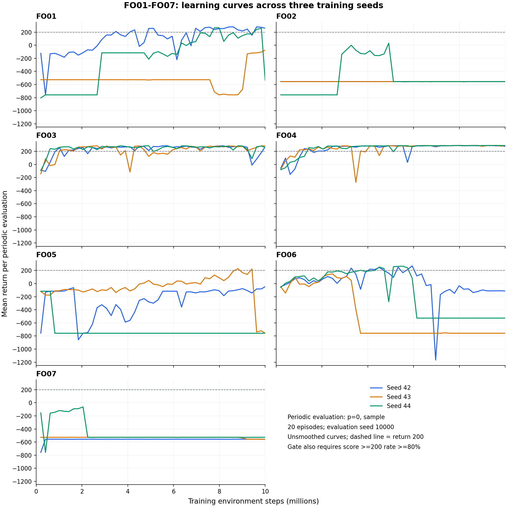
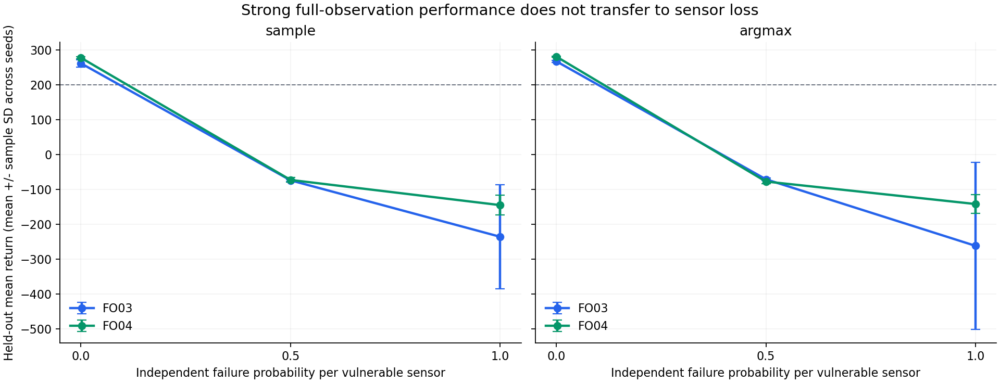

# LunarLander PPO-POMDP 第一阶段分析报告：FO01–FO07

报告日期：2026-11-09（北京时间）  
实验批次：`baseline-v1`  
阶段范围：全观测组件对照；每组 3 个训练种子，每次请求 1,000 万步。

## 1. 阶段结论

**本阶段已完成全观测基础配置选型，建议下一阶段沿用 FO04：独立 Actor/Critic 骨干、学习率从 `3e-4` 线性降至 0、保留优势标准化、关闭价值裁剪、熵系数固定为 `0.01`。** FO04 三个种子均通过预先规定的末期连续达标门槛，末五次周期评估的跨种子平均回报为 **285.95 ± 2.18**，最终权重在全观测留出评估中取得 **277.13 ± 2.68** 分（sample）和 **280.63 ± 1.60** 分（argmax）。

本阶段最有解释力的结果是：**独立骨干使本批次训练更容易学会全观测着陆；在独立骨干下，线性学习率进一步改善了末期表现和稳定性。** 单独给共享骨干添加线性学习率没有取得收益；关闭优势标准化、价值裁剪 `0.2`、熵系数线性下降这三项单独修改也没有产生可进入下一阶段的候选。

**全观测达标尚未转化为传感器缺失下的适应能力。** FO04 在 `p=0.5` 和 `p=1` 的 sample 留出评估中分别只有 **−73.30 ± 6.52** 和 **−145.55 ± 28.71** 分，≥200 分比例分别为 **0.7%** 和 **0%**。下一阶段需要直接比较部分观测训练与课程训练。

| 阶段问题 | 本批次回答 | 结论边界 |
|---|---|---|
| 基础方法能否学会全观测任务？ | 能；FO03、FO04 的最终权重均有较高成绩 | 只验证了当前环境、模型宽度、预算和三个种子 |
| 哪个已训练配置最适合继续研究？ | 按既定规则选择 FO04 | 选型依据来自周期评估；留出成绩作补充验证 |
| 共享骨干是否足够稳定？ | 当前设置下不足；FO01 只有 1/3 种子通过末期门槛 | 不能推广为所有共享骨干 PPO 都不稳定 |
| 是否已解决部分观测任务？ | 尚未；所有组在 `p=1` 的两种策略下 ≥200 分比例均为 0 | 本阶段所有模型都只在 `p=0` 下训练 |

## 2. 数据范围与统计口径

### 2.1 完整性与可比性

数据来自批次状态清单当前选定的 attempt，未混入烟测、其他批次或历史重试。批次时间戳范围为 **2026-11-06 18:01 至 2026-11-09 02:50（北京时间）**。

| 核验项 | 本次结果 |
|---|---|
| 训练组与种子 | FO01–FO07 × seed 42、43、44，共 21 次；均为 `attempt-0001` |
| 训练预算 | 每次实际 9,998,336 步、4,882 次 PPO 更新；合计 209,965,056 步 |
| 训练日志 | 共 102,522 行；更新编号、累计步数和最终预算一致 |
| 周期评估 | 每次训练 49 次，每次 20 回合；共 1,029 次评估 |
| 留出评估 | 21 个最终权重 × 3 个缺失概率 × 2 种动作策略，共 126 次、12,600 回合 |
| 产物校验 | 重新计算并核对 525 项已登记文件哈希，全部一致，包含 21 个 `latest.pt` |
| 统计复核 | 从逐回合数据重算周期/留出均分和 ≥200 分比例；与现有汇总一致 |
| 分组与选型 | 49 个汇总条件均有效；重新执行现有分组和选型逻辑，结果仍为 FO04 |
| 源码与环境 | 所有正式运行指纹一致；当前训练源码指纹也与批次记录一致 |

哈希一致说明当前文件与入口验收时的产物一致。本次报告没有重新训练、重新评估模型或重新加载权重做推理。

### 2.2 统一设置

- 环境为 `LunarLander-v3`，离散 4 动作、无风、原始奖励，最大回合长度 1,000 步。
- 所有组均从随机初始化开始，以全观测 `p=0` 训练；模型输入保留 8 维读数、8 维可用性提示和 4 维上一动作，共 20 维。
- Transformer 为 D256、4 层、4 heads、每层窗口 32；保留上一动作，残差门控初值 `1e-4`。
- 采样设置为 8 环境 × 256 步，rollout 为 2,048 步；序列长度 64，每 minibatch 4 条序列，最多 4 epochs。
- PPO 公共参数为 `gamma=0.99`、`GAE lambda=0.95`、策略裁剪 `0.2`、价值系数 `0.5`、全局梯度裁剪 `0.5`、`target_kl=0.02`。
- 周期评估每 100 次更新进行一次，并在最后一次更新补评；使用 sample、8 环境、20 回合、起始 seed 10000。
- 留出评估统一使用最终 `latest.pt`，8 环境、100 回合、起始 seed 20000；分别报告 sample 和 argmax，评估 `p=0/0.5/1`。
- 运行设备为 NVIDIA GeForce RTX 4090 Laptop GPU；Python 3.11.14、PyTorch 2.9.1+cu128、Gymnasium 1.2.2、NumPy 2.4.6、box2d-py 2.3.5。21 次训练均启用编译，使用 FP32，关闭 TF32/AMP，评估协议统一为 `batched-policy-v2`。

每次实际步数为 `floor(10,000,000 / 2,048) × 2,048 = 9,998,336`，各组预算一致。

### 2.3 指标定义

本报告所有“均值 ± 标准差”均先在每个训练种子内计算指标，再对 **3 个训练种子**求均值和**样本标准差**。它们不表示 300 个独立训练样本，也不是置信区间。

“末五次周期评估”对应 update `4500、4600、4700、4800、4882`，即约 921.6 万至 999.8 万训练步。先对每个种子的这五次成绩取平均，再跨种子汇总。“末次周期评估”只取 update 4882；两者不能混用。

单种子的末期门槛为：**最后连续两次周期评估均满足平均回报 ≥200，且回报 ≥200 的回合比例 ≥80%**。组级候选至少要有 2/3 种子通过，再按末五次平均回报、末五次 ≥200 分比例、组 ID 排序。

“≥200 分比例”是回报阈值指标，不等同于着陆事件比例。`positive_terminal` 表示终止奖励为 +100；`terminal_penalty` 表示终止奖励为 −100，单凭该标志无法区分所有失败原因，因此本报告不将它直接称为坠毁率。

## 3. 全观测结果

### 3.1 七组对照与训练末期表现

| 组别 | 骨干及差异项 | 末五次均分 ± SD | 末五次 ≥200 比例 | 末次均分 ± SD | 末期通过 |
|---|---|---|---|---|---|
| FO01 | 共享；固定学习率（基线） | 64.83 ± 175.86 | 47.0% | -116.49 ± 398.72 | 1/3 |
| FO02 | 共享；线性学习率 | -555.81 ± 0.13 | 0.0% | -555.73 ± 0.00 | 0/3 |
| FO03 | 独立；固定学习率 | 211.55 ± 50.23 | 75.7% | 270.44 ± 12.12 | 2/3 |
| FO04 | 独立；线性学习率 | 285.95 ± 2.18 | 99.3% | 283.47 ± 8.33 | 3/3 |
| FO05 | 共享；关闭优势标准化 | -406.97 ± 334.57 | 9.7% | -520.76 ± 410.90 | 0/3 |
| FO06 | 共享；价值裁剪 0.2 | -465.48 ± 327.76 | 0.0% | -466.17 ± 326.64 | 0/3 |
| FO07 | 共享；熵系数线性下降 | -546.58 ± 16.89 | 0.0% | -547.28 ± 17.89 | 0/3 |

各组相对 FO01 的差异均与原实验设计一致。FO01–FO04 构成骨干与学习率的 2×2 对照；FO05–FO07 分别只修改 FO01 的一个组件。

**只有 FO03 和 FO04 满足组级候选门槛。** FO04 的末五次均分比 FO03 高 **74.40** 分，跨种子标准差从 **50.23** 降至 **2.18**，末五次 ≥200 分比例从 **75.7%** 提升至 **99.3%**。因此 FO04 的优势主要体现在末期持续保持成绩。

### 3.2 最终权重的全观测留出评估

| 组别 | sample 均分 ± SD | sample ≥200 比例 | argmax 均分 ± SD | argmax ≥200 比例 |
|---|---|---|---|---|
| FO01 | -119.49 ± 413.79 | 31.3% | -118.39 ± 416.88 | 33.7% |
| FO02 | -576.10 ± 0.00 | 0.0% | -576.10 ± 0.00 | 0.0% |
| FO03 | 261.27 ± 10.40 | 91.0% | 267.17 ± 2.98 | 95.3% |
| FO04 | 277.13 ± 2.68 | 96.0% | 280.63 ± 1.60 | 97.7% |
| FO05 | -564.06 ± 441.00 | 3.3% | -566.28 ± 437.14 | 3.3% |
| FO06 | -495.11 ± 350.86 | 0.0% | -495.67 ± 349.98 | 0.0% |
| FO07 | -565.48 ± 18.30 | 0.0% | -565.54 ± 18.27 | 0.0% |

FO03 和 FO04 在未用于周期评估的环境种子上仍保持高分，支持全观测训练结果具有一定泛化性。FO04 相对 FO03 的 sample 平均回报高 **15.86** 分，≥200 分比例高 **5.0 个百分点**；argmax 平均回报高 **13.46** 分。

FO04 的 sample 与 argmax 结果接近，分别为 277.13 和 280.63 分，说明其高分不依赖仅报告某一种动作选择方式。其他失败组在 argmax 下也没有恢复，改变评估动作策略不足以补救这些最终权重。

FO02 的跨种子标准差显示为 `0.00`，反映三个种子都接近相同的失败行为，不能解读为高质量的稳定收敛；表中数值也经过两位小数舍入。

## 4. 学习过程与组件解释



图中每条线对应一个训练种子，纵轴为独立周期评估均分，未做平滑。虚线仅标示均分 200，完整门槛还包含 ≥200 分比例 ≥80%。

### 4.1 独立骨干：本批次最主要的改善来源

在固定学习率下，FO03 相对 FO01 的全观测 sample 留出均分从 **−119.49** 提升到 **261.27**，末期通过种子从 **1/3** 增至 **2/3**。在线性学习率下，FO04 相对 FO02 的 sample 均分从 **−576.10** 提升到 **277.13**，末期通过种子从 **0/3** 增至 **3/3**。两组比较方向一致，支持下一阶段采用独立骨干。

这仍然是**同宽度、不同总参数量**的比较：共享模型为 **3,219,981** 个参数，独立模型为 **6,438,677** 个参数，接近翻倍。因此现有实验无法将收益完全归因于消除了策略/价值梯度干扰，额外容量也可能参与其中。独立骨干仍使用一个 Adam 和全局梯度裁剪，也没有完全隔离两条分支的优化联系。

### 4.2 线性学习率：收益依赖骨干设置

FO04 相对 FO03 的末期稳定性改善明显，但 FO02 相对 FO01 没有改善。这说明在本批次中，**独立骨干与学习率调度存在明显的组合差异**，不能把线性学习率概括为对所有模型都有收益。

FO03 三个种子首次连续两次达标分别出现在约 **164、143、82 万步**；FO04 分别为约 **143、123、164 万步**。两组早期学会任务的速度没有呈现一致的单方向优势，FO04 的选型依据更多来自训练后半程和末期的稳定性。

FO04 也出现过中期回落，例如 seed 43 和 seed 42 的曲线均有短暂低谷，因此不宜写成“全程无波动”。更准确的描述是：**在当前预算末期，FO04 三个种子均能持续保持高分。**

### 4.3 共享基线存在不同失败轨迹

FO01 的三条运行不能用一个跨种子均值概括：

- **seed 42**：末期通过门槛，sample 留出均分 **271.44**，≥200 分比例 **94%**。
- **seed 43**：周期评估最高均分仍只有 **−74.54**，本预算内没有学会任务；sample 留出均分 **−77.03**。
- **seed 44**：曾连续达标；倒数第二次周期评估为 **258.36** 分、≥200 分比例 **95%**，最后一次却降到 **−534.52** 分、比例 **0%**。最终权重 sample 留出均分 **−552.87**，右侧推动作占约 **94.05%**。

FO03 的 seed 42 也展示了末次成绩与末期稳定性的区别：最后五次均分约为 **259.7、−10.4、81.8、181.0、268.7**。最终权重已经恢复，但倒数第二次仍未达标，所以该种子没有通过连续门槛。这解释了为什么 FO03 最终留出成绩较好，选型上仍弱于 FO04。

### 4.4 三个附加组件未形成可用候选

**FO05：关闭优势标准化。** 末期通过为 0/3，sample 留出均分 **−564.06 ± 441.00**。seed 43 曾在单次周期评估达到 **227.37** 分，但训练末期退化；seed 43、44 的最终留出轨迹几乎持续执行主引擎动作。当前证据支持保留优势标准化，但尚未在独立骨干上验证关闭它的影响。

**FO06：价值裁剪 `0.2`。** 末期通过为 0/3，sample 留出均分 **−495.11 ± 350.86**。三个种子的周期最高均分分别约为 **269.97、147.94、265.08**，说明部分运行曾学到较好的行为，却未保持到最终。最后 500 次更新中，日志记录的价值预测相对旧价值变化超过 `0.2` 的 token 比例平均约 **86.7%**；这说明该阈值频繁被触及，但不等于这些 token 的梯度全部被截断。结合当前成绩，`0.2` 没有提供预期的稳定收益，不能将其作为已验证的有益组件。

**FO07：熵系数线性下降。** 末期通过为 0/3，sample 留出均分 **−565.48 ± 18.30**。seed 42、43 的最终行为主要为左侧推，seed 44 主要为右侧推。部分退化在系数尚未接近 0 时已经出现：seed 42 从约 **41 万步**起，后续周期评估左侧推动作均超过 99%，当时熵系数仍约 **0.00959**。因此无法把失败简单归因为“末期熵系数降到零”。

FO02 的 seed 42、43 在第一次周期评估（约 20 万步）就已出现接近单一左侧推动作的行为，之后没有恢复。这同样不支持把 FO02 的失败仅归因为训练末期学习率归零。

## 5. 优化诊断与计算成本

### 5.1 接受更新、样本覆盖与价值拟合

| 组别 | KL 停止率 | 平均样本复用 | 唯一覆盖率 | 末期 EV | 留出策略熵 |
|---|---|---|---|---|---|
| FO01 | 50.8% | 2.73 | 93.0% | 0.846 | 0.39207 |
| FO02 | 10.7% | 3.79 | 99.2% | 0.977 | 0.00029 |
| FO03 | 42.9% | 2.97 | 92.1% | 0.895 | 0.36675 |
| FO04 | 27.1% | 3.38 | 95.9% | 0.957 | 0.27353 |
| FO05 | 58.6% | 2.44 | 90.9% | 0.900 | 0.04543 |
| FO06 | 53.5% | 2.62 | 90.1% | 0.886 | 0.00745 |
| FO07 | 11.8% | 3.75 | 98.8% | 0.973 | 0.00299 |

表中 KL 停止率是触发 `ppo_early_stop` 的更新比例；复用次数为每个 rollout 样本的平均接受访问次数，允许多 epoch 重复；覆盖率是至少参与过一次接受更新的唯一样本比例。EV 为最后 500 次更新的 explained variance 均值。动作熵来自最终权重在 `p=0/sample` 留出轨迹上的平均策略分布熵，再对训练种子取平均。

FO04 相对 FO03 的 KL 停止率由 **42.9%** 降至 **27.1%**，平均样本复用从 **2.97** 提升至 **3.38**，唯一覆盖率从 **92.1%** 提升至 **95.9%**。这些指标与 FO04 末期更平稳的表现一致。

但更新充分不等于任务学会：FO02、FO07 的覆盖率接近 99%，样本复用也接近上限 4，最终策略仍失败。它们的末期 EV 分别约 **0.977** 和 **0.973**，高于成功的 FO04 约 **0.957**；价值网络可以较好拟合失败策略产生的回报，单看 EV 不能判断任务成功。

FO02 的留出策略熵约 **0.00029**，FO07 约 **0.00299**，与其近乎单一动作的轨迹一致。FO05、FO06 的较低熵也伴随部分种子行为退化。这里的熵描述的是策略分布；argmax 与 sample 的动作选择方式不能替代这一诊断。

### 5.2 梯度与行为概率一致性

21 次运行共 102,522 次更新中，行为旧概率与 PPO 重算的一致性警告均为 **0**；最大 log-prob 误差约 **4.91×10⁻⁵**，低于 `1e-4` 警告阈值。现有日志未发现这一检查所能识别的概率重算不一致，但这不能替代对所有实现细节的正确性证明。

梯度探针显示，共享骨干上策略目标和价值目标的梯度方向并不总一致。例如 FO01 三个种子的共享梯度夹角为负的探针比例约为 **50.5%、60.6%、53.5%**。FO01 seed 42 的价值/策略目标梯度范数比中位数约 **627 倍**；退化策略中的比值还会因策略梯度很小而大幅上升。

这些结果支持“共享表示可能受到策略与价值目标相互影响”这一解释，但**没有单独证明它就是退化原因**。探针只使用每次重诊断的固定首批 256 个学习 token，每条运行共 99 次；数值包含当前熵项与价值系数，不能代表整个 rollout 的平均梯度。独立骨干的共享梯度夹角没有定义。

此外，几乎所有被接受的 optimizer step 都触发了全局梯度裁剪。这是本批次所有组的共同现象，不能仅凭触发比例区分成功和失败，也不能把原始梯度范数比直接解释为 Adam 参数更新幅度比。

### 5.3 参数量与耗时

| 组别 | 总参数量 | 单次训练小时 ± SD | 周期评估占比 | 平均 optimizer steps |
|---|---|---|---|---|
| FO01 | 3,219,981 | 2.52 ± 0.18 | 1.54% | 106,531 |
| FO02 | 3,219,981 | 2.78 ± 0.12 | 0.57% | 147,940 |
| FO03 | 6,438,677 | 3.25 ± 0.14 | 1.47% | 115,880 |
| FO04 | 6,438,677 | 3.30 ± 0.03 | 1.32% | 131,897 |
| FO05 | 3,219,981 | 2.46 ± 0.23 | 1.14% | 95,142 |
| FO06 | 3,219,981 | 2.58 ± 0.17 | 2.26% | 102,265 |
| FO07 | 3,219,981 | 2.90 ± 0.06 | 0.48% | 146,539 |

每次运行若完整执行所有 minibatch，计划 optimizer step 总数为 **156,224**；表中为实际接受并执行的平均次数。相同环境步数并不意味着相同梯度更新次数。

按元数据中的 `elapsed_seconds`，21 次训练累计约 **59.40 小时**，其中周期评估累计约 **43.90 分钟**，占合计训练计时约 **1.23%**；126 次留出评估的评估器内部计时累计约 **14.10 分钟**，不含各进程完整启动开销。

**耗时存在计时口径限制。** 训练元数据使用 `perf_counter`，状态清单起止时间使用 UTC 时间戳；本批次两者并不完全一致。例如 FO01 seed 42 的训练元数据为 8,480.73 秒，而 attempt 时间戳差约为 8,039.79 秒；该差异的原因尚未核实。因此上表用于记录日志内的成本指标，不据此推断精确的批次墙钟总时长，也不对小幅耗时差作性能结论。按日志口径，FO04 单次训练时间约为 FO01 的 **1.31 倍**，需要同时考虑参数量翻倍、有效更新次数及轨迹长度等差异。

## 6. 传感器缺失泛化

这里的 `p` 是 `vx、vy、angle、angular_velocity` **各通道在每个时间步独立缺失的概率**。`p=1` 时这四个通道持续缺失，位置与双腿接触仍可用；它不表示全部观测消失。缺失读数置零，同时提供可用性提示。

以下模型均只在 `p=0` 训练。本节评估的是最终全观测策略直接面对传感器缺失时的表现。

| 组别 | 策略 | p=0.5 均分 ± SD | p=0.5 ≥200 比例 | p=1 均分 ± SD | p=1 ≥200 比例 |
|---|---|---|---|---|---|
| FO01 | sample | -233.62 ± 257.62 | 0.3% | -262.79 ± 236.98 | 0.0% |
| FO01 | argmax | -233.74 ± 255.06 | 0.3% | -258.33 ± 244.40 | 0.0% |
| FO02 | sample | -576.10 ± 0.00 | 0.0% | -576.09 ± 0.01 | 0.0% |
| FO02 | argmax | -576.10 ± 0.00 | 0.0% | -576.10 ± 0.00 | 0.0% |
| FO03 | sample | -74.51 ± 3.06 | 0.0% | -236.38 ± 149.40 | 0.0% |
| FO03 | argmax | -71.45 ± 3.39 | 1.0% | -262.37 ± 239.12 | 0.0% |
| FO04 | sample | -73.30 ± 6.52 | 0.7% | -145.55 ± 28.71 | 0.0% |
| FO04 | argmax | -77.88 ± 6.33 | 0.3% | -142.42 ± 26.43 | 0.0% |
| FO05 | sample | -573.01 ± 408.91 | 0.3% | -590.82 ± 393.58 | 0.0% |
| FO05 | argmax | -574.04 ± 407.10 | 0.0% | -590.85 ± 393.61 | 0.0% |
| FO06 | sample | -497.21 ± 347.52 | 0.0% | -510.77 ± 325.87 | 0.0% |
| FO06 | argmax | -497.33 ± 347.34 | 0.0% | -509.30 ± 328.39 | 0.0% |
| FO07 | sample | -565.54 ± 18.29 | 0.0% | -565.54 ± 18.29 | 0.0% |
| FO07 | argmax | -565.54 ± 18.29 | 0.0% | -565.54 ± 18.29 | 0.0% |



图中点和误差线为三个训练种子的均值与样本标准差；不是回合标准差或置信区间。

FO04 的 sample 均分从 `p=0` 的 **277.13** 降至 `p=0.5` 的 **−73.30**，下降约 **350.43** 分；在 `p=1` 时降至 **−145.55**，下降约 **422.68** 分。三个种子在 `p=1/sample` 下均无 ≥200 分回合，且均为 100% `terminal_penalty`，没有超时。这说明当前失败并非仅由等待到时间上限造成，但尚不能从终止标签识别具体失败机制。

FO04 在 `p=1` 的均分好于 FO03，但两者 ≥200 分比例都为 0，不能据此宣称 FO04 已获得有效的缺失传感器控制能力。在 `p=0.5`，两组分数也都约为 −70，差距很小，缺少支持“线性学习率显著增强传感器鲁棒性”的证据。

模型具有历史窗口和上一动作输入，仍不足以从本阶段结果证明它已学会用历史补偿缺失状态。全观测训练中缺失提示始终为“可用”，评估时读数和提示的分布同时变化；当前实验没有区分这两种分布变化各自的影响，也未进行记忆长度或上一动作消融。

## 7. 下一阶段建议

### 7.1 将 FO04 作为完整配置候选

按既定周期评估规则，FO03、FO04 分别有 2/3、3/3 个种子通过门槛，FO04 以末五次平均回报领先，选型无需借助留出成绩。本报告复核了七组齐全、种子完整、源码和预算可比，满足本阶段的选型前提。

建议保留 **FO04 实际训练过的完整组合**：独立骨干、学习率 `3e-4 → 0`、优势标准化开启、价值裁剪关闭、熵系数恒定 `0.01`，其余公共参数不变。FO05–FO07 只在共享骨干下单独验证过，不能将它们直接拼入 FO04 并称为已验证配置。

批次已有 `selection.json`，但截至本次报告检查，**尚无 `frozen-recipe.json`**；本次只新增分析材料，没有执行配置冻结或启动后续训练。下一阶段应先保存冻结配置和源码指纹，再开始新的比较。

### 7.2 比较三种部分观测训练方案

| 条件 | 训练观测方案 | 主要研究问题 |
|---|---|---|
| FO04 参考 | 复用本阶段全观测运行，p=0 | 提供全观测参考成绩以衡量缺失观测带来的差距 |
| PO01 | 从头训练，始终 p=1 | 直接在目标缺失条件下训练能否学会任务 |
| PO02 | 固定课程：前 10% 为 p=0，中间 70% 线性增至 1，最后 20% 为 p=1 | 固定退化课程是否改善目标任务学习 |
| PO03 | 成绩课程：每级 p 增加 0.1，连续两次满足 200 分/80% 门槛才推进 | 按掌握程度推进能否改善稳定性与最终成绩 |

每个新条件均使用 seed 42、43、44，从随机初始化训练相同 1,000 万步；“复用 FO04”指复用其全观测参考成绩，新的 PO 训练仍应从头开始。三个新条件只改变观测方案，模型和优化参数沿用 FO04。

成绩课程必须同时记录是否进入 `p=1`、最终 `p`、各阶段步数和最终任务是否达标；预算完成不意味着课程完成。跨课程比较应使用最终权重在统一 `p=0/0.5/1`、sample/argmax 条件下的评估，不能直接用各自训练结束时不同 `p` 的周期分数排序。

先完成 1,000 万步比较再决定是否做 5,000 万步实验。长预算应独立从头训练，因为学习率与固定课程都依赖总预算，不能把本阶段的最终权重续接视为相同实验。

### 7.3 需要保留的研究边界

- **训练种子只有 3 个。** 当前结果足以支持本批次内部选型，不支持强统计显著性或广泛算法优越性结论。
- **骨干比较没有匹配总参数量。** 若后续需要解释独立骨干为何有效，应另设等参数量等对照，继续区分容量和优化因素。
- **全观测结果不能替代部分观测结果。** 第二阶段的核心证据应来自 `p=1` 成绩与课程推进过程，不能只展示全观测高分。
- **留出协议需要继续保持独立。** 统一入口已经生成各组 seed 20000 的留出成绩；当前选型仍按原定周期规则重算。若以后据这些留出成绩继续调组件或课程，应增加新的独立评估种子，避免重复使用同一留出集形成选择偏差。
- **本报告使用最终权重。** 部分失败组保存过较好的周期权重，但没有以最优中间权重替换它们的最终权重；如另研究早停或 checkpoint 选择，应作为新的预先规定协议。

## 附录 A：逐训练种子的关键结果

| 组别 | 训练 seed | 首次连续达标（百万步） | 末五次均分 | 末期通过 | p=0/sample 留出均分 | 留出 ≥200 比例 |
|---|---|---|---|---|---|---|
| FO01 | 42 | 4.30 | 242.15 | 通过 | 271.44 | 94% |
| FO01 | 43 | — | -109.53 | 未通过 | -77.03 | 0% |
| FO01 | 44 | 7.99 | 61.86 | 未通过 | -552.87 | 0% |
| FO02 | 42 | — | -555.73 | 未通过 | -576.10 | 0% |
| FO02 | 43 | — | -555.96 | 未通过 | -576.10 | 0% |
| FO02 | 44 | — | -555.74 | 未通过 | -576.10 | 0% |
| FO03 | 42 | 1.64 | 156.17 | 未通过 | 262.72 | 94% |
| FO03 | 43 | 1.43 | 254.15 | 通过 | 250.22 | 83% |
| FO03 | 44 | 0.82 | 224.34 | 通过 | 270.87 | 96% |
| FO04 | 42 | 1.43 | 283.55 | 通过 | 275.13 | 96% |
| FO04 | 43 | 1.23 | 286.51 | 通过 | 276.08 | 95% |
| FO04 | 44 | 1.64 | 287.80 | 通过 | 280.17 | 97% |
| FO05 | 42 | — | -92.01 | 未通过 | -54.84 | 10% |
| FO05 | 43 | — | -370.72 | 未通过 | -818.63 | 0% |
| FO05 | 44 | — | -758.20 | 未通过 | -818.72 | 0% |
| FO06 | 42 | — | -111.36 | 未通过 | -122.21 | 0% |
| FO06 | 43 | — | -758.20 | 未通过 | -818.72 | 0% |
| FO06 | 44 | 4.71 | -526.88 | 未通过 | -544.42 | 0% |
| FO07 | 42 | — | -556.17 | 未通过 | -576.10 | 0% |
| FO07 | 43 | — | -556.49 | 未通过 | -575.98 | 0% |
| FO07 | 44 | — | -527.07 | 未通过 | -544.35 | 0% |

“首次连续达标”指训练过程中首次满足连续两次门槛时，第二次评估对应的累计训练步数，单位为百万步。它不保证之后保持成绩；“—”表示从未满足。末期通过仍仅依据最后两次周期评估。

## 附录 B：数据来源与复核路径

本报告优先读取原始产物，并与现有汇总交叉核对：

- [批次状态与当前 attempt 清单](../runs/experiments/baseline-v1/state.json)
- [运行概况](../runs/experiments/baseline-v1/summary/overview.md)
- [现有成绩汇总](../runs/experiments/baseline-v1/summary/summary.md)与[结构化统计](../runs/experiments/baseline-v1/summary/summary.json)
- [配置候选](../runs/experiments/baseline-v1/summary/selection.json)
- [实验配置定义](../experiments.json)、[阶段门槛与后续设计](../EXPERIMENTS.md)、[统计和选型实现](../summarize_experiments.py)
- [本次复核脚本](../runs/experiments/baseline-v1/report-analysis/analyze_stage1.py)与[本次计算结果](../runs/experiments/baseline-v1/report-analysis/statistics.json)

逐运行目录按状态清单解析，当前均为以下形式：

```text
runs/experiments/baseline-v1/tasks/
  train--FOxx--seedNN/attempt-0001/run/
    metadata.json
    training.csv
    diagnostics.csv
    evaluation.csv
    evaluation_episodes.csv
    checkpoints/latest.pt
  eval--FOxx--seedNN--pP--POLICY/attempt-0001/run/
    metadata.json
    evaluation.json
    episodes.csv
```

其中 `pP` 为 `p0`、`p0.5`、`p1`，`POLICY` 为 `sample` 或 `argmax`。逐回合 CSV 按回合完成顺序写入，JSON 按 episode 编号排序；交叉核验时按 episode 编号对齐。

源码指纹：

```text
47786bd7215381980b7c74452a38ab74173a1fa3ed34b188166ef49ad271f179
```

运行时 Git 工作区为 dirty，因此本报告以产物记录的源码指纹为复现依据，不将 Git commit 单独视为完整源码快照。`runs/` 属于 Git 忽略目录，数据来源链接和复核脚本依赖本地实验产物；转交报告时应至少同时保留本 Markdown 与 `assets/` 下的两张图。
