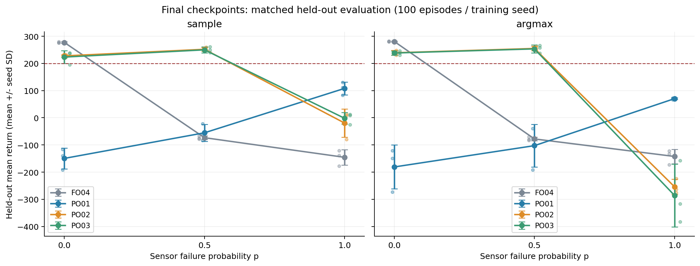
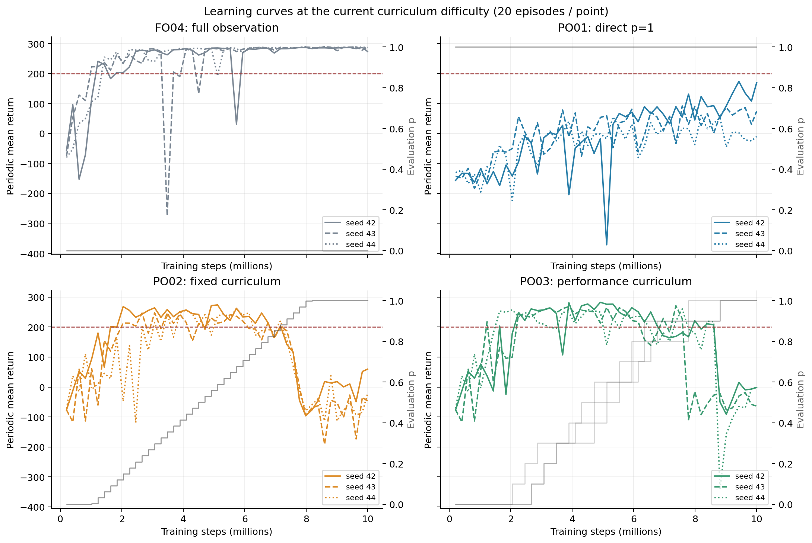
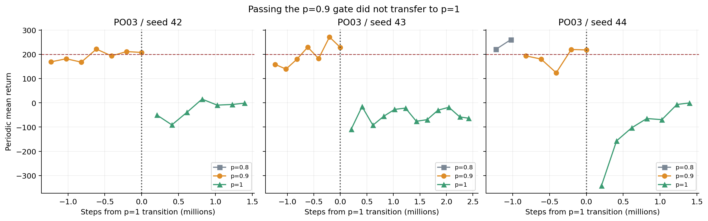
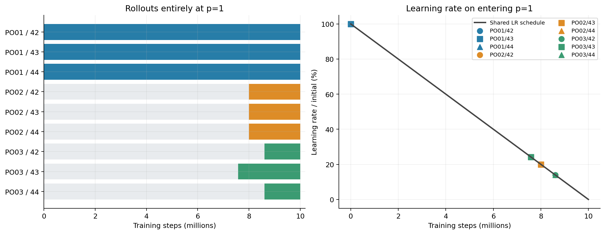
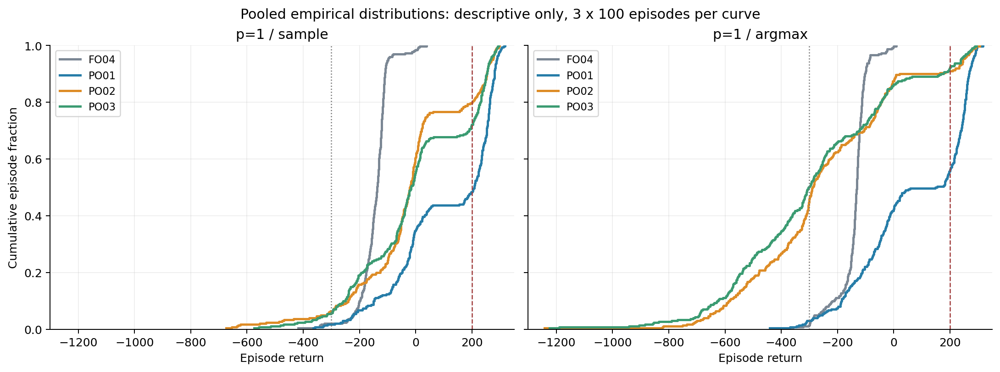
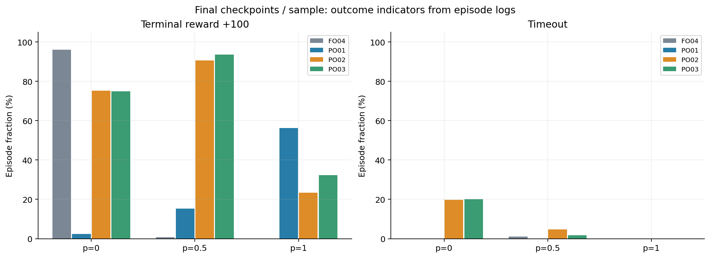

# LunarLander PPO-POMDP 第二阶段报告：课程学到了什么，又在哪里失效？

报告日期：2026-11-10（北京时间）  
正式批次：`course-10m-v1`；全观测参考：`baseline-v1 / FO04`  
研究范围：冻结 FO04 配置后，比较直接部分观测训练、固定课程和成绩课程；每组 3 个训练种子，每次请求 1,000 万步。

## 1. 主要发现

**第二阶段最明确的结果是：课程训练很好地适应了间歇性传感器缺失，却没有解决四个目标通道持续缺失的最终任务。** 两种课程在 `p=0.5` 的最终留出评估中达到约 **250 分、90%–95% 的 ≥200 分比例**，远高于只做全观测训练的 FO04。但在 `p=1` 下，直接从头训练的 PO01 更好：sample 均分 **108.11 ± 23.83**，高于固定课程的 **−19.40 ± 52.10** 和成绩课程的 **−1.83 ± 20.96**。

**另一个突出的现象是，课程模型在 `p=1` 下的 sample 与 argmax 表现完全不同。** PO02 从 sample 的 −19.40 分降至 argmax 的 **−253.99** 分；PO03 从 −1.83 分降至 **−285.78** 分。这个差异在两种课程的三个训练种子中都出现，且伴随更多极低回报回合、更高的主引擎动作占比和更大的终止姿态偏差。

**成绩课程的三个种子都完成了十次推进、到达 `p=1`，但九次新增训练没有一次满足最终任务的连续达标门槛。** “课程跑完”“进入最终难度”和“学会最终任务”应分开判断。

| 研究问题 | 本批次的回答 | 证据边界 |
|---|---|---|
| 课程能否提高缺失传感器下的表现？ | 在 `p=0.5` 下改善很大，两种动作策略均成立 | 仅验证了三个留出缺失概率，尚无连续鲁棒性曲线 |
| 课程是否优于直接 `p=1` 训练？ | 在 `p=1` 的最终留出成绩上没有；PO01 三个种子的 sample 均分都更高 | 三种方案的最终难度训练时长和学习率不同 |
| 成绩门槛能否保证下一难度可解？ | 不能；三个种子从 `p=0.9` 到 `p=1` 后首次评估均大跌 | 切换前后还隔着 100 次更新，不是同一权重的即时对照 |
| argmax 能否作为 sample 的等价替代？ | 不能；课程模型在 `p=1` 下出现明显退化 | 现有日志支持行为差异，尚不能定位每一步的控制机制 |
| 是否已经学到可靠的记忆推断？ | 当前成绩不足以证明 | 没有无历史、短历史或状态重建的消融 |

如果下一步只围绕 `p=1` 提升成绩，**PO01 应保留为直接训练基线**；如果关注间歇性失灵，PO02、PO03 都是有效候选。当前证据不足以选出一个在所有观测条件下都占优的第二阶段方案。

## 2. 实验设计与数据口径

### 2.1 比较了什么

第一阶段已按预定规则选择 FO04。本阶段冻结其训练配置，所有新增模型均从随机初始化开始，**没有用 FO04 权重微调或续训**。FO04 的三个训练结果和十八次留出评估作为既有参考复用。

| 条件 | 训练时的观测方案 | 每个种子的请求预算 | 作用 |
|---|---|---:|---|
| FO04 | 全程 `p=0` | 1,000 万步，复用第一阶段 | 检查全观测能力及直接缺失泛化 |
| PO01 | 全程 `p=1` | 1,000 万步 | 直接学习最终部分观测任务 |
| PO02 | 前 10% 为 `p=0`，中间 70% 线性升至 1，最后 20% 为 `p=1` | 1,000 万步 | 固定进度课程 |
| PO03 | 从 `p=0` 开始；连续两次评估同时满足均分 ≥200、≥200 分比例 ≥80%，才增加 `p=0.1` | 1,000 万步 | 成绩门槛课程；失败重置连续计数，不回退 |

这里的 `p` 是 `vx、vy、angle、angular_velocity` **各通道、各环境、各时间步独立缺失的概率**。位置 `x、y` 和双腿接触始终可用；`p=1` 也保留这四个受保护通道。缺失读数置零，并提供可用性提示，因此“真实读数为零”和“读数缺失”可区分。

模型输入统一为 **20 维：8 维掩码读数 + 8 维可用性 + 4 维上一动作 one-hot**。Actor 和 Critic 使用相同的可见信息，没有把完整真实状态、奖励或课程进度作为额外模型输入。

公共配置为独立 Actor/Critic 骨干，Transformer D256、4 层、4 heads、每层窗口 32，总参数 **6,438,677**；保留上一动作，残差门控初值 `1e-4`。PPO 使用 8 环境 × 256 步、序列长度 64、每 minibatch 4 条序列、最多 4 epochs；学习率 `3e-4` 全程线性降至 0，优势标准化开启，价值裁剪关闭，熵系数固定 `0.01`，`gamma=0.99`、GAE `lambda=0.95`、策略裁剪 `0.2`、价值系数 `0.5`、全局梯度裁剪 `0.5`、`target_kl=0.02`。

环境为 `LunarLander-v3`，离散四动作、无风、原始奖励，最大回合长度 1,000 步。正式训练设备为 RTX 4090 Laptop GPU，Python 3.11.14、PyTorch 2.9.1+cu128、Gymnasium 1.2.2、NumPy 2.4.6、box2d-py 2.3.5；FP32，关闭 TF32/AMP，评估协议统一为 `batched-policy-v2`。

### 2.2 完整性核验

本报告从状态清单的当前 attempt 读取产物，没有递归混入烟测或历史尝试。新增任务的时间戳范围为 **2026-11-09 10:20 至 2026-11-10 16:30（北京时间）**。

| 核验项 | 结果 |
|---|---|
| 新增任务 | 9 次训练 + 54 次留出评估，63/63 完成，全部为 `attempt-0001` |
| 复用参考 | FO04 的 3 次训练 + 18 次留出评估，不计入新增任务 |
| 实际训练预算 | 每次 9,998,336 步、4,882 次更新；新增合计 **89,985,024 步** |
| 训练日志 | 12 条比较运行共 **58,584 行**；更新编号与累计步数逐行一致 |
| 周期评估 | 新增 441 次，复用 147 次；共 588 次、11,760 条回合记录 |
| 留出评估 | 新增 54 次，复用 18 次；共 72 次、7,200 条回合记录 |
| 逐回合复算 | 共复算 18,960 条周期/留出回合记录；10,044 项数值比对通过 |
| 产物哈希 | 本阶段、冻结选型证据及参考共 **429 项唯一登记文件**，重算全部一致，包含最终权重 |
| 来源与依赖 | 留出评估的训练 run ID、checkpoint 哈希和配置对应；正式运行环境与冻结配置一致 |
| 源码指纹 | 当前训练源码与冻结指纹一致：`47786bd7…271f179` |
| 汇总有效性 | 24 个留出条件均有效，重算均值、样本 SD、≥200 分比例、超时比例与原汇总一致 |

实际步数为 `floor(10,000,000 / 2,048) × 2,048 = 9,998,336`。上述哈希核验覆盖冻结记录登记的文件，不代表整个目录中的所有文件都逐一校验。本次没有重新训练、加载 checkpoint 做推理或补充评估，也没有修改 `runs/` 中的产物。完整记录见 [audit.json](stage2-analysis/audit.json) 和 [artifact-audit.csv](stage2-analysis/artifact-audit.csv)。

### 2.3 如何读这些数字

除特别说明外，**“均值 ± SD”先在每个训练种子内部计算，再对 seed 42、43、44 求均值与样本标准差**；SD 不是置信区间。每个权重的 100 个留出回合不能当作 100 个独立训练重复。

周期评估每 100 次更新运行 20 回合，并在 update 4882 补评；使用 sample、8 环境、环境种子 10000–10019，难度是当时课程的 `p`。留出评估统一使用最终 `latest.pt`、8 环境、100 回合、环境种子 20000–20099，在 `p=0/0.5/1` 下分别运行 sample 和 argmax。环境、传感器和 sample 动作随机流按回合种子确定。

周期评估的环境种子会重复使用，且 PO03 用这些成绩决定推进。因此它既是观测信号，也是课程反馈，不能替代留出评估。sample 与 argmax 使用相同的初始环境种子，但动作和后续轨迹不同。

“≥200 分比例”是回报阈值指标；`positive_terminal` 是日志记录的终止奖励 +100，`terminal_penalty` 是终止奖励 −100；三者不混用。终止惩罚也不单独区分坠毁、越界等原因。本报告以日志中的指标原义描述行为。

## 3. 最终权重：间歇失灵和持续失灵给出了不同答案



图中误差棒为三个训练种子之间的样本 SD，淡色点为各训练种子的均分。连线用于引导阅读，仅有 `p=0、0.5、1` 三个实测点，不表示中间概率已评估。

### 3.1 sample 留出评估

| 条件 | p=0 均分 ± SD | ≥200 比例 | p=0.5 均分 ± SD | ≥200 比例 | p=1 均分 ± SD | ≥200 比例 |
|---|---:|---:|---:|---:|---:|---:|
| FO04 | 277.13 ± 2.68 | 96.0% | −73.30 ± 6.52 | 0.7% | −145.55 ± 28.71 | 0.0% |
| PO01 | −149.53 ± 38.47 | 2.0% | −55.31 ± 31.32 | 12.0% | **108.11 ± 23.83** | **51.7%** |
| PO02 | 227.72 ± 3.76 | 75.3% | **251.98 ± 6.72** | 90.3% | −19.40 ± 52.10 | 20.3% |
| PO03 | 223.38 ± 24.05 | 73.7% | 249.99 ± 10.88 | **93.0%** | −1.83 ± 20.96 | 28.0% |

### 3.2 argmax 留出评估

| 条件 | p=0 均分 ± SD | ≥200 比例 | p=0.5 均分 ± SD | ≥200 比例 | p=1 均分 ± SD | ≥200 比例 |
|---|---:|---:|---:|---:|---:|---:|
| FO04 | **280.63 ± 1.60** | **97.7%** | −77.88 ± 6.33 | 0.3% | −142.42 ± 26.43 | 0.0% |
| PO01 | −181.02 ± 80.81 | 2.0% | −102.64 ± 78.93 | 14.3% | **70.40 ± 3.08** | **44.0%** |
| PO02 | 239.14 ± 8.80 | 86.0% | **255.07 ± 8.02** | 93.7% | −253.99 ± 27.56 | 9.0% |
| PO03 | 238.30 ± 8.05 | 88.0% | 253.44 ± 14.81 | **95.3%** | −285.78 ± 115.35 | 7.7% |

**间歇失灵方面，课程收益很清楚。** 在 `p=0.5/sample` 下，PO02、PO03 相对 FO04 的均分分别提高 **325.28、323.30 分**；相对直接部分观测训练 PO01，也分别高 **307.29、305.31 分**。argmax 下结论相同。两种课程之间的均分差只有约 2 分，且均分与 ≥200 分比例的排序不同，当前不能据此宣布其中一种全面更好。

**持续失灵方面，直接训练更好。** 在 `p=1/sample` 下，PO01 分别比 PO02、PO03 高 **127.50、109.94 分**，而且三个相同编号训练种子的比较方向一致。PO01 的 +100 终止比例为 **56.3%**，表明它已学到相当一部分有效行为，但其均分与 ≥200 分比例仍明显低于最终任务门槛。

**训练分布适应并不自动带来跨分布鲁棒性。** PO01 在自己的训练条件 `p=1` 下最好，恢复传感器后却变差；FO04 在 `p=0` 下最好，出现失灵后迅速失效。额外输入读数及其可用性模式对 PO01 是训练中没有出现过的变化，因此不能把这个结果解释为“真实信息本身有害”。

课程模型保留了较好的 `p=0` 能力，并大幅改善了 `p=0.5`，却没有跨过 `p=1` 的障碍。这更符合“学会了应对间歇缺失”的描述；尚不能称为对全缺失范围都可靠的策略。

## 4. 学习过程：瓶颈集中在课程终点



彩色线为各训练种子的周期均分，未平滑；灰色线对应右轴，表示各周期评估的缺失概率。PO02 的评估概率随步数增加，PO03 随达标情况分级增加。**不同曲线的同一横坐标可能对应不同难度，不能直接用曲线面积或全程均分给课程排序。**

### 4.1 固定课程在接近终点时共同回落

PO02 三个种子在中间难度保持较高成绩，但到约 `p=0.9` 后开始共同下降。以下均分和比例均先按种子计算，再跨种子平均：

| PPO update | 评估 p | 三种子平均回报 | ≥200 分比例 |
|---|---:|---:|---:|
| 3500 | 0.88131 | 208.93 | 80.0% |
| 3600 | 0.91058 | 161.51 | 65.0% |
| 3700 | 0.93984 | 99.94 | 43.3% |
| 3800 | 0.96910 | −21.08 | 13.3% |
| 3900 | 0.99836 | −90.16 | 1.7% |
| 4000 | 1.00000 | −68.48 | 6.7% |

这个回落不是单个种子的末次异常，而且 **update 3900 还未完全到 `p=1`**。固定课程会按时推进，即使当前难度已经失分，也不会停下来等待恢复。到末期，三个种子的 `p=1` 周期最高均分也仅为约 **59.55、−26.82、37.91** 分。

### 4.2 成绩课程通过了门槛，却没有把能力带到 p=1

PO03 三个种子都完成了 `0 → 0.1 → … → 1` 的十次推进。逐项复核转换前的两次评估，均确实满足原定门槛。它们在 `p=0.9` 分别训练 **2,048,000、1,433,600、1,024,000 步**，所以不能说课程在这一阶段完全没有等待。



图中横轴 0 是完成 `p=0.9` 达标评估并切换课程的时刻；0 处的点仍属于 `p=0.9`。首次 `p=1` 评估在后续 100 次更新、即 204,800 个训练步后进行。

| seed | 切入 p=1 的累计步数 | 最后两次 p=0.9 均分 | 对应 ≥200 比例 | 首次 p=1 均分 | 首次 ≥200 比例 | 相对切换前末次变化 |
|---|---:|---|---|---:|---:|---:|
| 42 | 8,601,600 | 211.13 / 207.59 | 85% / 80% | −50.08 | 15% | −257.67 |
| 43 | 7,577,600 | 271.22 / 228.20 | 100% / 90% | −109.14 | 10% | −337.34 |
| 44 | 8,601,600 | 219.90 / 217.83 | 85% / 85% | −341.64 | 5% | −559.47 |

三个种子在进入 `p=1` 后的周期最高均分分别只有 **15.14、−15.83、−0.77** 分；截至预算结束都没有恢复到此前阶段的高分水平。PO03 把中间阶段推进得更有条件，但**“在当前 p 达标”不足以保证下一 p 的策略初始化已经合适**。

切换前后比较涉及难度变化、训练更新、环境轨迹及随机动作变化，因此它不能单独证明某一个原因。最直接的后续验证是：使用同一个 `p=0.9` 转换 checkpoint，在多个新环境种子上立即评估 `p=0.9、0.95、0.98、1`，分离难度变化和后续优化的影响。

### 4.3 为什么 0.9 到 1 可能是一个特别难的终点

从传感器生成规则可直接算出：四个目标通道在一个时刻全部缺失的概率为 `p⁴`。

- `p=0.5`：四个通道同时缺失的概率为 **6.25%**，至少一个可见的概率为 **93.75%**。
- `p=0.9`：四个通道同时缺失的概率为 **65.61%**，仍有 **34.39%** 的时刻至少出现一个目标通道读数；每个特定通道平均每 10 步可见一次。
- `p=1`：四个目标通道从回合开始到结束都不可见，历史中也不会再出现这些通道的读数。

因此，数值上最后增加 0.1，对历史信息的含义却很大：此前的策略仍可能利用偶尔出现的速度、角度或角速度读数校正判断；到 `p=1` 后，必须完全依靠位置、接触和动作历史作控制。**这是由观测规则支持的解释，但当前实验没有测出模型是否真的采用了这种校正机制。**

同样，PO01 在 `p=1` 能得到部分高分，说明当前输入和模型组合可以学到一些有效控制，但并没有证明 Transformer 已正确重建了所有隐状态，也没有证明历史机制优于无记忆策略。

## 5. 最终难度的训练时间与学习率纠缠在一起

所有方案的总环境步数相同，但 **在最终任务上得到的训练时间不同**；统一沿用的全程线性学习率，又让课程在到达最难阶段时只剩较小更新幅度。



| 方案 / seed | 全程 p=1 的完整 rollout 步数 | 占总步数 | 首个完整 p=1 rollout 的学习率 | 相对初始学习率 | p=1 阶段名义学习率之和占比 |
|---|---:|---:|---:|---:|---:|
| PO01 / 全部 | 9,998,336 | 100.0% | 3.000×10⁻⁴ | 100.0% | 100.0% |
| PO02 / 全部 | 1,998,848 | 20.0% | 5.993×10⁻⁵ | 20.0% | 3.99% |
| PO03 / 42 | 1,396,736 | 14.0% | 4.186×10⁻⁵ | 14.0% | 1.95% |
| PO03 / 43 | 2,420,736 | 24.2% | 7.259×10⁻⁵ | 24.2% | 5.86% |
| PO03 / 44 | 1,396,736 | 14.0% | 4.186×10⁻⁵ | 14.0% | 1.95% |

最后一列定义为 `sum(lr_u，完整 p=1 的更新) / sum(lr_u，所有更新)`，每轮只计一次名义学习率。**它只是调度分配的描述，不是有效学习量、参数位移或可等价换算的训练预算**；Adam 状态、梯度、KL 拒绝和每轮实际 optimizer steps 都会影响真实更新。

PO02 的既有课程汇总按向量采样边界推导出 `p=1` 为 **1,999,664 步**；本表从 `training.csv` 只计“起始概率已为 1 的完整 rollout”，得到 **1,998,848 步**，相差 816 步来自跨过阈值的边界 rollout。两种口径不能混写。PO03 使用日志记录的离散阶段，完整 rollout 统计与阶段步数完全一致。

这些数字使“课程学不好最终任务”的解释需要更谨慎：**当前比较证明的是这三套完整训练方案在固定总预算下的差异，不能把 PO01 的优势单独归因于没有课程。** 课程既花时间学习较易任务，又在较低学习率下才集中接触最终任务。这个调度组合值得优先做对照，但现有结果还不能证明它就是失败原因。

成绩课程中，seed 43 比其余种子更早到 `p=1`，留给最终阶段的步数更多，但 sample 留出也没有形成明显领先，周期末次反而更低。因此三个种子也不支持“只要更早到达，就一定更好”的简单解释。

## 6. sample 与 argmax：差异集中在最终部分观测条件

### 6.1 不是一个异常种子拉低了平均数

| 方案 | seed | p=1 sample 均分 | ≥200 比例 | p=1 argmax 均分 | ≥200 比例 |
|---|---:|---:|---:|---:|---:|
| PO01 | 42 | 130.43 | 59% | 72.72 | 45% |
| PO01 | 43 | 110.88 | 55% | 71.57 | 43% |
| PO01 | 44 | 83.01 | 41% | 66.91 | 44% |
| PO02 | 42 | 13.96 | 25% | −275.80 | 10% |
| PO02 | 43 | −79.44 | 11% | −263.16 | 7% |
| PO02 | 44 | 7.28 | 25% | −223.02 | 10% |
| PO03 | 42 | 11.77 | 33% | −382.32 | 4% |
| PO03 | 43 | 8.70 | 25% | −158.04 | 13% |
| PO03 | 44 | −25.96 | 26% | −316.98 | 6% |

PO02 三个种子的 sample 均分分别比 argmax 高 **289.75、183.72、230.30 分**；PO03 分别高 **394.09、166.74、291.02 分**。因此组均值的差异具有一致方向。

这个现象又明显依赖观测条件：在 `p=0.5` 下，PO02、PO03 的 argmax 均分反而分别比 sample 高约 **3.10、3.45 分**；在 `p=0` 下，argmax 也略高。因此不宜概括为“随机选动作总是更好”。

### 6.2 argmax 出现了更重的低回报尾部



每条经验分布包含三个训练种子各 100 回合，合并只用于描述形状；统计独立重复数仍为 3，未对这 300 回合做训练层面的显著性检验。图中保留了全部回报范围，包括约 −1,241 分的极端回合。

| 条件 / 策略 | +100 终止比例 | 回报 <−300 比例 | 主引擎动作占比 | 平均回合长度 | 终止时平均绝对角度 |
|---|---:|---:|---:|---:|---:|
| PO01 / sample | 56.3% | 1.7% | 30.1% | 195.4 | 0.288 |
| PO01 / argmax | 50.3% | 3.0% | 33.4% | 193.6 | 0.332 |
| PO02 / sample | 23.3% | 6.3% | 38.1% | 142.6 | 0.574 |
| PO02 / argmax | 10.0% | **46.0%** | **48.8%** | 165.4 | **1.531** |
| PO03 / sample | 32.3% | 5.7% | 35.9% | 167.4 | 0.509 |
| PO03 / argmax | 11.0% | **50.3%** | **51.4%** | 185.8 | **1.386** |

角度为环境原始 `angle` 通道的绝对值，单位为弧度；此处使用终止时完整状态作离线诊断，不表示训练时模型能看到被屏蔽的角度。动作占比先在每条训练运行的留出轨迹上按步数计算，再跨三个训练种子平均。

课程模型在 argmax 下不仅少了一部分高分回合，还出现明显更重的低回报尾部；主引擎使用增加，终止姿态偏差扩大，平均回合更长。它们在 `p=1` 的超时比例仍是 0，所以这里的退化不由达到 1,000 步超时主导。

**与现有证据相符的解释**是：持续缺失时，课程策略对随机动作选择较敏感，直接把一个较分散的动作分布取最大值，可能改变了原有控制行为。但现有日志没有逐步保存 logits、姿态和动作序列，不能证明是连续开主引擎、某类动作切换减少或某个特定状态触发了失败。

同时，argmax 轨迹上的策略分布熵仍然可以很高：PO02、PO03 在 `p=1/argmax` 下记录的平均策略熵分别约 **0.801、0.753**。这是网络输出分布的熵，**不是实际 argmax 动作选择的随机性**；而且它们与 sample 熵是在不同轨迹上测得，不能直接当作同一批状态的策略变化。

下一阶段应继续并列报告 sample 和 argmax，避免只选较好的一种评估方式。若要判断随机性在控制中具体起什么作用，应补充同种子轨迹及逐步概率记录，再考虑温度或动作选择的对照。

## 7. 为什么课程模型在 p=0.5 下比全观测还好？

这是本阶段另一个稳定出现的非单调结果。PO02 的 sample 均分从 `p=0` 的 **227.72** 提升到 `p=0.5` 的 **251.98**；PO03 从 **223.38** 提升到 **249.99**。argmax 下也存在同方向差异。



| 条件 / 策略 | p=0 超时比例 | p=0.5 超时比例 | p=0 平均长度 | p=0.5 平均长度 |
|---|---:|---:|---:|---:|
| PO02 / sample | 19.7% | 4.7% | 405.5 | 247.1 |
| PO03 / sample | 20.0% | 1.7% | 407.7 | 242.3 |
| PO02 / argmax | 8.0% | 1.3% | 290.6 | 223.4 |
| PO03 / argmax | 5.0% | 0.7% | 307.7 | 239.1 |

在 `p=0/sample` 下，两种课程的 +100 终止比例都约为 **75%**，终止惩罚约为 **5%**，约 **20%** 的回合走满 1,000 步。到 `p=0.5` 时，+100 终止比例上升至 **90.7%、93.7%**，超时明显减少，而终止惩罚仍约为 **4.7%**。

这些结果说明，课程在全观测条件下的得分损失不只是更多终止惩罚；**长回合未及时结束也是一个重要行为差异**。argmax 同时减少了课程模型在 `p=0` 下的超时，但还未达到 FO04 的零超时和约 280 分水平。

这里可以提出两个待验证解释：训练后策略对间歇性掩码的输入分布更适应；或者掩码变化改变了接近着陆时的动作选择，减少了未结束的长回合。**单靠终止汇总无法确认这些超时回合是在悬停、地面接触后未静止，还是其他状态**，也不能据此声称“传感器失灵改善了物理任务”。后续应优先查看 `p=0` 的超时轨迹，并与相同初始种子的 `p=0.5` 回合对照。

## 8. 优化诊断与成本

### 8.1 更新执行正常，不代表最终任务已学会

| 条件 | KL 停止率 | 平均样本复用 | 唯一覆盖率 | 末期 EV | 平均 optimizer steps | 单次训练小时 ± SD |
|---|---:|---:|---:|---:|---:|---:|
| FO04 | 27.1% | 3.38 | 95.9% | 0.957 | 131,897 | 3.30 ± 0.03 |
| PO01 | 1.5% | 3.96 | 99.7% | 0.817 | 154,817 | 3.21 ± 0.04 |
| PO02 | 15.2% | 3.63 | 96.6% | 0.844 | 141,692 | 3.07 ± 0.13 |
| PO03 | 15.9% | 3.62 | 96.7% | 0.821 | 141,205 | 3.22 ± 0.17 |

KL 停止率、复用和覆盖率统计整个训练过程；EV 是最后 500 次更新的 explained variance，再跨种子平均。课程训练不同阶段的采样分布不同，不能把整程优化统计直接解释为同一个固定任务上的差异。

PO01 的样本复用接近最大值 4、唯一覆盖率接近 100%，但最终任务仍未达标。这说明它的不足并非简单由大量 rollout 没被更新使用造成。两种课程的末期 EV 也都在 0.82–0.84 左右，没有仅凭这些汇总指标就能确诊的优化异常；价值拟合程度不能替代任务表现。

十二条比较运行的 **58,584 次更新中，旧行为概率与 PPO 重算的一致性警告均为 0**；最大绝对 log-prob 误差约 **2.19×10⁻⁵**，低于 `1e-4` 警告阈值。该项检查支持“这些日志未出现其能识别的概率重算不一致”，不构成所有实现细节均正确的证明。

### 8.2 末期分数不能代替统一留出比较

最后五次周期评估是 update `4500、4600、4700、4800、4882`，本批次 PO01–PO03 在这五次中均已到 `p=1`：

| 条件 | 末五次均分 ± SD | 末次均分 ± SD | 末期难度 |
|---|---:|---:|---|
| FO04 | 285.95 ± 2.18 | 283.47 ± 8.33 | p=0 |
| PO01 | 66.74 ± 76.90 | 77.81 ± 89.77 | p=1 |
| PO02 | −42.64 ± 49.81 | −3.66 ± 55.98 | p=1 |
| PO03 | −35.21 ± 23.16 | −22.04 ± 36.07 | p=1 |

PO01 的 seed 44 在周期末五次平均只有 **−9.73** 分，但最终权重的 `p=1/sample` 留出均分是 **83.01**。这提醒我们，固定 20 回合周期评估既有环境种子差异，也有小样本波动；单个周期分数不能当成模型的精确总体能力。最终跨方案比较仍应以统一条件、100 回合的留出结果为主。

### 8.3 耗时

按训练元数据的 `elapsed_seconds`，九次新增训练累计 **28.50 小时**，其中周期评估累计 **22.71 分钟**，占比约 **1.33%**；54 次新增留出评估的评估器内部计时累计 **12.13 分钟**。这不含留出评估进程的全部启动成本。

状态时间戳显示本批次跨越约 **30 小时 10 分钟**。`perf_counter` 训练计时与状态起止时间不是完全相同的口径，部分运行还存在明显数值差异，例如 PO01 seed 42 的训练元数据约 **11,412 秒**，attempt 起止差约 **12,219 秒**。原因尚未核实，不能用表中小幅耗时差宣布某种课程更快。

## 9. 可以得出的结论与下一轮优先级

本阶段最有价值的进展，是把“传感器缺失鲁棒性”拆成了几个实际表现不同的问题：**间歇性失灵可以通过课程显著改善；持续失灵仍难；课程终点存在明显性能落差；随机策略和贪心执行在最终难度下也不等价。** 这比只看一次最终均分更能指导下一轮实验。

以下是建议的验证顺序，不表示本次已经启动新实验：

| 优先级 | 下一步实验 | 主要区分的问题 | 需要控制或报告的条件 |
|---|---|---|---|
| 1 | 对现有转换权重和最终权重做密集 `p` 扫描，重点补 `0.9、0.95、0.98、1` | 终点难度变化与继续训练的影响分别有多大 | 使用同一权重、独立环境种子，同时报告 sample/argmax；保留新留出集 |
| 2 | 固定课程起点，比较原线性衰减与进入 `p=1` 后保留学习率的方案 | 学习率是否限制最终任务适应 | 保持课程和总步数相同，一次先改一个调度因素 |
| 3 | 对齐 `p=1` 阶段训练步数，比较直接训练与课程初始化 | 课程是否为最终任务提供更有用的初始化 | 同时报总预算和最终难度预算；明确初始化及 Adam 状态处理 |
| 4 | 记录 `p=1` 下 sample/argmax 的逐步概率、动作、真实诊断状态，以及 `p=0` 超时轨迹 | 极端低回报和长回合究竟如何产生 | 同一初始种子对照；完整状态只用于分析，不加入模型输入 |
| 5 | 在受控预算下做历史长度、无历史、上一动作等消融 | 收益是否来自历史推断，模型依赖哪些输入 | 避免同时改变模型容量和多项优化参数 |

如果只选一项继续训练对照，建议先检验 **“最终阶段的学习率与训练时长是否足够”**。若预算允许，使用“是否保留最终阶段学习率 × 是否增加最终阶段步数”的完整小规模对照，比同时修改两项后只看一组结果更容易解释。增加训练种子后，再考虑更正式的不确定性估计；当前三个种子不支持普遍性或显著性的强结论。

需要保留的边界还有：FO04 来自第一阶段选型，并非全新未选择过的参考；当前留出种子用于本报告后，后续若据此调参就应另留确认集；本次只分析最终 `latest.pt`，没有事后改用中间最佳 checkpoint；性能曲线没有覆盖其他失灵机制、风扰动或环境版本。

## 10. 复现与产物索引

在仓库根目录、具有 NumPy/Pandas/Matplotlib 的 Python 环境中运行：

```powershell
python -B .\lunarlander-ppo-pomdp\reports\scripts\analyze_stage2.py
```

脚本只读取正式批次当前 attempt 和冻结参考，重算登记文件哈希、配置与来源、逐回合指标、分组统计和课程转换门槛，生成本报告的六张图和分析数据；不依赖 Box2D 推理，不反序列化权重，也不改写正式实验目录。本次离线分析环境为 NumPy 2.2.6、Pandas 2.3.3、Matplotlib 3.10.6，与正式训练环境分别记录。

| 产物 | 内容 |
|---|---|
| [分析脚本](scripts/analyze_stage2.py) | 从已选 attempt 读取、校验并生成统计与图表 |
| [核验摘要](stage2-analysis/audit.json) / [哈希明细](stage2-analysis/artifact-audit.csv) | 数据范围、环境、计数与 429 项文件核验 |
| [留出逐种子结果](stage2-analysis/heldout-seeds.csv) / [跨种子结果](stage2-analysis/heldout-groups.csv) | 72 次评估及 24 个条件的详细指标 |
| [留出逐回合数据](stage2-analysis/heldout-episodes.csv) | 7,200 回合，带条件、训练种子及环境种子 |
| [训练逐种子统计](stage2-analysis/training-seeds.csv) / [跨种子统计](stage2-analysis/training-groups.csv) | 最终阶段预算、学习率、优化诊断与成本 |
| [周期评估](stage2-analysis/periodic-evaluations.csv) | 588 次周期评估，标明对应难度和训练种子 |
| [课程转换](stage2-analysis/transitions.csv) / [阶段步数](stage2-analysis/performance-stages.csv) | PO03 各次推进门槛及切换后首次评估 |
| [固定课程终点数据](stage2-analysis/fixed-cliff.csv) / [策略差异](stage2-analysis/policy-differences.csv) | PO02 终点回落、逐种子的 sample−argmax 差值 |
| [数据说明](stage2-analysis/README.md) | 文件口径及重运行说明 |

原始证据入口：[第二阶段 overview](../runs/experiments/course-10m-v1/summary/overview.md)、[统一条件汇总](../runs/experiments/course-10m-v1/summary/summary.md)、[冻结配置](../runs/experiments/course-10m-v1/frozen-recipe.json)、[第一阶段报告](FO01-FO07-stage1-analysis.md)。本报告的机制解释以本地配置、实现和日志为依据，尚未通过额外因果对照验证。
