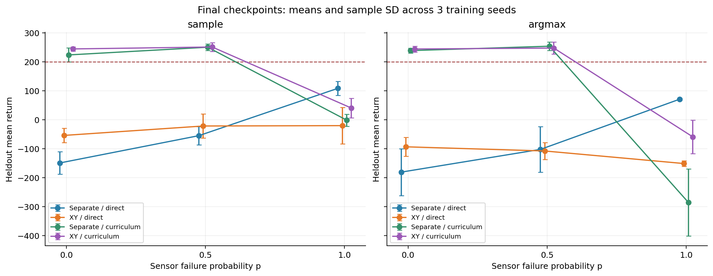
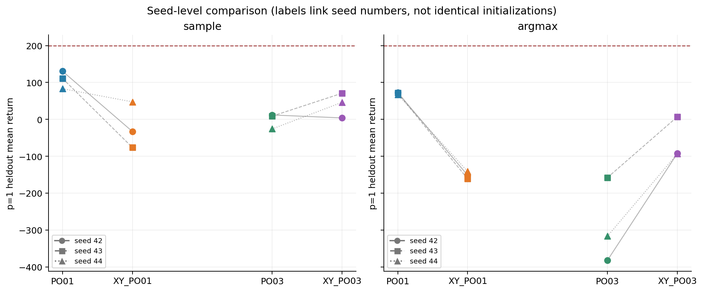
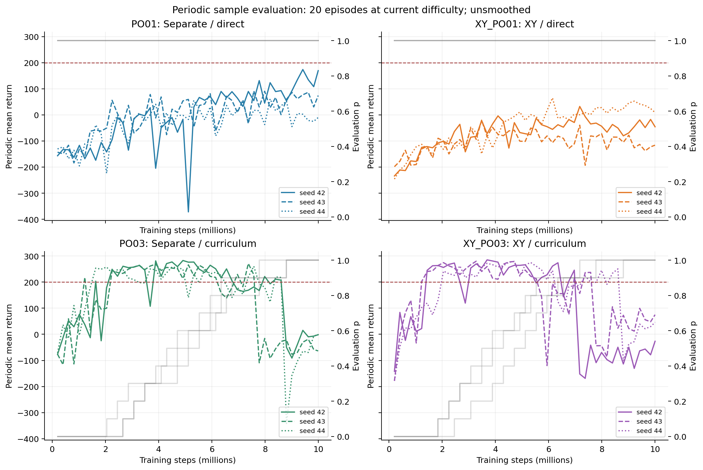
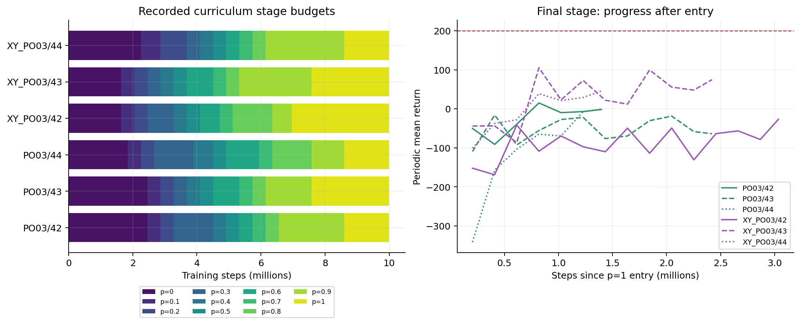
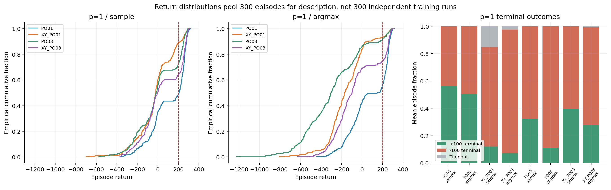
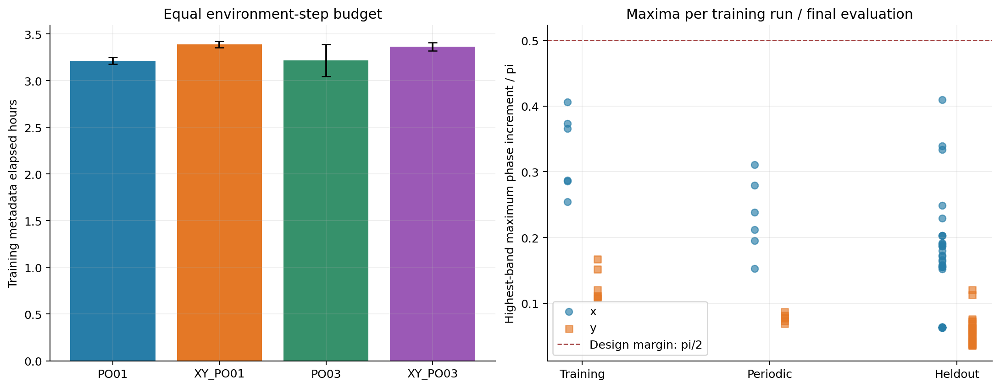

# LunarLander PPO-POMDP：固定 XY Fourier 输入实验报告

报告日期：2026-11-13（北京时间）  
实验批次：`xy-fourier-10m-v1`；历史参考：`course-10m-v1 / PO01、PO03`  
运行入口：`powershell -NoProfile -ExecutionPolicy Bypass -File .\lunarlander-ppo-pomdp\run_xy_fourier.ps1`

## 1. 结论：直接训练明显退步，课程局部改善，最终任务仍未解决

**本次结果不支持把这套固定 XY Fourier 输入作为原配方的默认替代。** 在四个目标传感器持续缺失的 `p=1` 下，直接训练组在 sample、argmax 两种策略中均退步，而且三个训练种子的变化方向一致。成绩课程组相对历史课程有所改善，但仍低于历史直接训练组，也没有达到预定任务门槛。

主要比较采用最终 `latest.pt`，每个训练种子、每个评估条件各运行 100 回合。下表均分为三个训练种子的均值 ± 样本标准差；“≥200”指单回合回报达到 200 的比例。

| 训练方案 / 策略 | 历史均分 | XY Fourier 均分 | 均分变化 | ≥200 比例：历史 → 新 |
|---|---:|---:|---:|---:|
| 直接训练 / sample | **108.11 ± 23.83** | −20.69 ± 62.79 | **−128.79** | 51.7% → 11.0% |
| 直接训练 / argmax | **70.40 ± 3.08** | −151.51 ± 9.99 | **−221.91** | 44.0% → 6.7% |
| 成绩课程 / sample | −1.83 ± 20.96 | **40.26 ± 33.82** | +42.09 | 28.0% → 36.0% |
| 成绩课程 / argmax | −285.78 ± 115.35 | **−59.57 ± 57.61** | +226.22 | 7.7% → 25.3% |

这组结果应同时保留以下判断：

- **直接训练的负面信号较一致。** sample 的三个同编号种子分别下降 163.47、187.26、35.65 分；argmax 全部下降超过 208 分。逐一去掉一个种子后，两种策略的平均变化仍全部为负。
- **课程改善具有条件性。** sample 为两个种子提高、一个略降；argmax 三个均提高。只有 seed 42 更早进入 `p=1`，但它恰好是 sample 略降的种子，不能简单将全部改善解释成最终难度训练时间增加。
- **六次新训练均未解决最终任务。** `final_task_solved` 全为 false，且每次训练在 `p=1` 的周期评估中连单次合格都没有。最终留出评估中最好的新模型是 `XY_PO03/43`，sample 均分 **70.77**、≥200 比例 **47%**。
- **没有记录到设计相位阈值越界。** 训练、周期评估与最终评估合计记录 61,950,501 次有效位置转移，达到 `π/2` 或 `π` 的计数均为零。这削弱了“退步源于记录到的相位越界”这一解释，但不证明编码在优化上合适。

以下分析是历史批次之间的探索性比较。训练种子只有三个，且两批次源码指纹不同，不能将均值差直接认定为纯 Fourier 编码的因果效应。

## 2. 实验设计与数据核验

### 2.1 本次改变了什么

实验保留独立的 Actor / Critic Transformer，只在原始输入后追加确定性位置特征：

```text
原输入：8 维读数 + 8 维可用性 + 4 维上一动作 = 20 维
x 追加：π、2π、4π、8π 的 sin / cos，共 8 维
y 追加：π、2π 的 sin / cos，共 4 维
新输入：32 维，原始坐标与其他输入完整保留
```

频率单位是每单位环境归一化坐标的弧度，不是时间 Hz。编码幅值为 1，不裁剪、不再次缩放坐标，也没有可学习参数。原始 x/y 已经可见，因此编码改变的是位置的表示方式，**没有增加可观测信息，也没有直接提供缺失的速度、倾角或角速度**。

总参数从 **6,438,677** 增至 **6,444,821**，增加 6,144 个权重，约 **0.095%**。模型仍为 D256、4 层、4 heads、每层窗口 32，残差门初值 `1e-4`，保留上一动作；策略与价值参数独立。新模型元数据记录的策略、价值输入历史上限均为 125，Fourier 输入没有扩大时间窗口。

频率选择及独立校准过程见 [设计报告](XY-PO01-PO03-design.md)。本报告只核验正式运行的记录，不重新调频，也不根据本次回报重新挑选频段。

### 2.2 训练及评估协议

| 条件 | 输入 | 观测方案 | 批次 |
|---|---|---|---|
| PO01 | 原始 20 维 | 全程 `p=1` | 历史 Stage2 |
| XY_PO01 | 32 维，含固定 XY Fourier | 全程 `p=1` | 本次 |
| PO03 | 原始 20 维 | 成绩门槛课程 | 历史 Stage2 |
| XY_PO03 | 32 维，含固定 XY Fourier | 相同成绩门槛课程 | 本次 |

`p` 是 `vx、vy、angle、angular_velocity` 各通道、各环境、各时间步独立缺失的概率。缺失读数置零，同时提供可用性标记；x、y 和双腿接触始终可见。因此 `p=1` 表示这四个目标通道持续不可见，不表示整个观测向量消失。

每组种子为 42、43、44，从头训练。每次请求 10,000,000 环境步，按完整 rollout 实际完成 **9,998,336 步、4,882 次 PPO 更新**；本次六次训练合计 **59,990,016 步**。

共同 PPO 配方为：8 环境 × 256 步；学习序列 64；每 minibatch 4 条序列；最多 4 epochs；学习率 `3e-4` 线性降至零；`gamma=0.99`、`gae_lambda=0.95`、`clip_coef=0.2`、`vf_coef=0.5`；优势标准化开启、价值裁剪关闭；熵系数固定 `0.01`；`target_kl=0.02`、最大梯度范数 `0.5`。课程从 `p=0` 开始，连续两次周期评估均满足均分 ≥200 且 ≥200 比例 ≥80%，才推进 0.1；失败重置连续计数，不回退。

- 周期评估使用 sample，每 100 次更新及最后一次更新评估 20 回合，种子 10000–10019，每次训练共 49 个点。课程评估使用当时难度，不能把全程高分都解释为 `p=1` 表现。
- 最终评估统一使用 `latest.pt`，在 `p=0、0.5、1` × sample / argmax 下各评估 100 回合，种子 20000–20099，8 环境，协议为 `batched-policy-v2`。sample 按策略分布抽样；argmax 取概率最高动作。
- 训练环境记录一致：Python 3.11.14、PyTorch 2.9.1、Gymnasium 1.2.2、NumPy 2.4.6、box2d-py 2.3.5，RTX 4090 Laptop GPU、CUDA 12.8；FP32、math SDPA、TF32/AMP 关闭。最长回合 1000 步。

逐项比较登记训练参数后，除开启 `xy_fourier` 外，仅有历史记录缺少的新默认字段 `decoder_layers=4`；该字段在 separate 模式下不参与网络。两批次仍分别保留各自源码指纹，参数相同并不代表全部实现严格相同。

### 2.3 核验范围和统计口径

本报告从 `state.json` 登记的当前 attempt 读取数据，未扫描任意同名权重拼接结果。本次 42 个任务全部完成，历史参考选取对应的 42 个任务；这 84 个任务均为 attempt 1、退出码 0。核验结果如下：

| 核验项 | 结果 |
|---|---:|
| 登记产物 SHA-256 校验 | 306 个文件，0 个不匹配 |
| 对照训练日志 | 12 次训练，共 58,584 行 |
| 对照周期评估 / 最终评估 | 588 / 72 次 |
| 从逐回合记录重算 | 18,960 回合，其中最终评估 7,200 回合 |
| 标量统计比对 | 10,044 项通过 |
| 本次源码与新批次指纹 | 一致 |

同时检查运行状态、预算、配置指纹、环境、最终权重依赖和训练来源；逐回合 JSON / CSV 互相核对，并将重算均分、比例和样本 SD 与保存汇总比较。权重只校验哈希，**没有反序列化 checkpoint，也没有重新训练或推理**。

统计先在单个训练种子内部完成，再等权汇总三个训练种子。跨种子 SD 使用 `ddof=1`，不是置信区间；300 个评估回合不能当作 300 次独立训练。同编号种子的差值只用于描述敏感性：输入投影形状变化也会改变初始化及随机数消费，不能视为严格匹配的初始权重。

最终评估种子已经参与过历史分析，因此这不是全新盲测。详细来源和校验记录见 [audit.json](xy-fourier-analysis/audit.json) 与 [artifact-audit.csv](xy-fourier-analysis/artifact-audit.csv)。

## 3. 最终评估：收益依赖训练方案与缺失概率



下表每格为“跨训练种子均分 ± 样本 SD；≥200 比例”。完整数值见 [复算结果表](xy-fourier-analysis/tables.md)。

### sample

| 组别 | p=0 | p=0.5 | p=1 |
|---|---:|---:|---:|
| PO01 | −149.53 ± 38.47；2.0% | −55.31 ± 31.32；12.0% | **108.11 ± 23.83；51.7%** |
| XY_PO01 | −54.39 ± 25.08；3.7% | −21.91 ± 41.34；8.3% | −20.69 ± 62.79；11.0% |
| PO03 | 223.38 ± 24.05；73.7% | 249.99 ± 10.88；93.0% | −1.83 ± 20.96；28.0% |
| XY_PO03 | **244.10 ± 7.24；91.7%** | **250.74 ± 14.89；94.3%** | 40.26 ± 33.82；36.0% |

### argmax

| 组别 | p=0 | p=0.5 | p=1 |
|---|---:|---:|---:|
| PO01 | −181.02 ± 80.81；2.0% | −102.64 ± 78.93；14.3% | **70.40 ± 3.08；44.0%** |
| XY_PO01 | −93.74 ± 32.20；9.3% | −108.18 ± 29.45；9.0% | −151.51 ± 9.99；6.7% |
| PO03 | 238.30 ± 8.05；88.0% | **253.44 ± 14.81；95.3%** | −285.78 ± 115.35；7.7% |
| XY_PO03 | **243.87 ± 10.12；92.0%** | 247.07 ± 21.12；94.0% | −59.57 ± 57.61；25.3% |

直接训练组在 `p=0` 的均分变得没那么负，并不能弥补目标 `p=1` 的下降；在 `p=0.5/sample` 下，均分提高而 ≥200 比例反而下降，两个指标也不应互相代替。课程组保留了 `p=0、0.5` 的高分表现，并提高最终难度成绩，但从 `p=0.5` 到 `p=1` 仍有明显落差。

本次课程方案的 `p=1/sample` 均分比本次直接方案高 **60.95 分**，说明 Fourier 表示与训练路径存在条件性差异；这不是“所有种子都受益于课程”，因为 seed 44 的 sample 均分反而略低。历史 PO01 在最终难度下仍优于本报告中的两个 Fourier 组。

## 4. 逐种子与学习曲线：直接训练的退步不是单个异常点



表中为“新模型均分（相比历史同编号种子的差值）”，均取 `p=1`：

| 组别 / 策略 | seed 42 | seed 43 | seed 44 |
|---|---:|---:|---:|
| XY_PO01 / sample | −33.03（−163.47） | −76.38（−187.26） | 47.36（−35.65） |
| XY_PO01 / argmax | −151.72（−224.44） | −161.39（−232.97） | −141.41（−208.32） |
| XY_PO03 / sample | 3.89（−7.88） | 70.77（+62.07） | 46.13（+72.09） |
| XY_PO03 / argmax | −92.35（+289.97） | 6.96（+165.00） | −93.30（+223.68） |

逐一去掉一个训练种子，直接组 sample 的平均差值仍介于 **−175.36 至 −99.56**，argmax 为 **−228.71 至 −216.38**；课程组分别为 **+27.10 至 +67.08** 和 **+194.34 至 +256.83**。这是描述性的敏感性检查，不是显著性检验，三个训练种子也不足以稳定估计总体效应。



图中为未平滑的周期 sample 评估，每个点只有 20 回合，灰线表示当前评估难度。直接组全程 `p=1`，课程组早中期的 200 分以上不能计入最终难度收敛。

`XY_PO01/42、43、44` 在 `p=1` 的最高周期均分分别为 **32.28、−20.33、64.97**，最后五次周期均分分别为 **−35.26、−123.12、32.69**。这表明直接组的问题不只是最后一次保存的权重偶然偏差。课程组的最高 `p=1` 周期均分也仅为 **−26.67、105.45、45.86**；六次新训练在最终难度都没有出现合格评估点。

周期种子和最终留出种子的结果并不完全一致。例如 `XY_PO03/42` 最后周期均分为 −26.67，而最终 sample 为 3.89。因此应保留两套协议，不从单个周期峰值替代最终评估，也不事后挑选最佳 checkpoint 宣称本次成功。

## 5. 课程轨迹：只有一个种子提前进入 p=1，断崖仍在



### 5.1 最终难度预算与学习率

| 种子 | 历史进入 p=1：百万步 | 新进入 p=1：百万步 | 历史 p=1 训练：百万步 | 新 p=1 训练：百万步 | 进入时学习率：历史 → 新 |
|---|---:|---:|---:|---:|---:|
| 42 | 8.602 | **6.963** | 1.397 | **3.035** | 4.19e−5 → 9.10e−5 |
| 43 | 7.578 | 7.578 | 2.421 | 2.421 | 7.26e−5 → 7.26e−5 |
| 44 | 8.602 | 8.602 | 1.397 | 1.397 | 4.19e−5 → 4.19e−5 |

跨种子平均，`p=1` 完整 rollout 预算从 **173.81 万步增加至 228.42 万步，约 +31.4%**；最终难度下名义学习率之和占全程比例从 **3.25% 增至 5.67%**。这只是学习率预算描述，不是实际参数更新量。

其中全部额外步数来自 seed 42：它提前 163.84 万步进入最终阶段，sample 却由 11.77 降至 3.89。seed 43、44 的进入时点、最终难度步数及进入学习率与历史相同，sample 分别提高 62.07、72.09。因此“多训练了一段 p=1”不能解释全部课程涨分。

另一方面，seed 43、44 **之前各阶段的停留时间仍不相同**，训练表示、初始化和到达最终阶段时的模型都不同；相同最终阶段预算也不足以构成受控的编码收益证明。完整阶段预算见 [performance-stages.csv](xy-fourier-analysis/performance-stages.csv)。

### 5.2 p=0.9 到 p=1 的落差没有消失

| XY_PO03 种子 | p=0.9 最后一次门槛均分 | 下一次 p=1 均分 | 变化 | 最终 p=1 留出 sample |
|---|---:|---:|---:|---:|
| 42 | 245.69 | −152.10 | −397.78 | 3.89 |
| 43 | 237.20 | −43.93 | −281.14 | 70.77 |
| 44 | 250.53 | −101.00 | −351.53 | 46.13 |

三个种子切换前的连续两次门槛均已核验。下一次评估发生在后续 100 次 PPO 更新之后，**不是同一权重在不同 p 下的即时测试**，所以落差同时包含难度变化与后续学习的影响。

在每通道独立缺失的设定下，`p=0.9` 时每步至少一个目标通道仍可见的概率是 `1−0.9^4=34.39%`；到 `p=1`，这样的读数完全消失。模型仍可能依赖间歇可见的速度、倾角或角速度，而未形成持续缺失时足够可靠的推断。这个解释与记录相容，尚不能由曲线证明，更不能据此断言 Transformer 记忆失效或位置历史必然足以恢复真实状态。

## 6. 终止结果：直接组高分回合流失，课程组极低回报减少



分布图合并每组 300 回合，仅用于描述。`+100` 正终止与 `−100` 终止惩罚来自日志，不等同于回报 ≥200；仅凭 `−100` 也不能进一步区分碰撞、越界等具体原因。

| p=1 条件 | +100 终止比例 | −100 终止比例 | 超时比例 | 回报 <−300 比例 |
|---|---:|---:|---:|---:|
| PO01 / sample | 56.3% | 43.7% | 0.0% | 1.7% |
| XY_PO01 / sample | **12.0%** | 73.0% | **15.0%** | 6.7% |
| PO01 / argmax | 50.3% | 49.7% | 0.0% | 3.0% |
| XY_PO01 / argmax | **7.3%** | **90.3%** | 2.3% | 17.0% |
| PO03 / sample | 32.3% | 67.7% | 0.0% | 5.7% |
| XY_PO03 / sample | 39.7% | 60.3% | 0.0% | 3.7% |
| PO03 / argmax | 11.0% | 89.0% | 0.0% | 50.3% |
| XY_PO03 / argmax | **28.0%** | 71.3% | 0.7% | **11.7%** |

直接组的退步同时体现在高分回合、正终止与失败比例上。`XY_PO01/42、43` 在 sample 下均为 **0% 的 ≥200 和 0% 的正终止**，超时比例分别为 28%、17%；seed 44 尚有 33% 的 ≥200，但仍低于原 seed 44 的 41%。这不是三个种子都只差一点接近门槛。

课程组的 argmax 改善伴随极低回报减少：`<−300` 比例从 50.3% 降至 11.7%，正终止从 11.0% 增至 28.0%。实际主引擎动作占比从 51.4% 降至 38.7%。这些是轨迹层面的共同变化，不能单凭动作占比就确定控制错误的原因。

sample 与 argmax 仍应分别报告。新直接组两者均分差为 **130.82 分**，新课程组为 **99.83 分**；课程差距较历史的 283.95 分缩小，但 argmax 仍明显弱于 sample。sample 评估的改善不自动适用于确定性执行。

## 7. 相位、安全余量与优化日志



### 7.1 没有观察到相位阈值越界

最高档单步相位按未取模的 `8π|Δx|`、`2π|Δy|` 记录。跨 rollout 累计计数、跨日志取最大值；终止步使用真实末帧，不将 reset 跳变记作位移。

| 记录范围 | 组别 | 有效转移数 | x 最大相位 / π | y 最大相位 / π | 达到 π/2 次数：x / y |
|---|---|---:|---:|---:|---:|
| 训练 | XY_PO01 | 29,995,008 | 0.40628 | 0.16737 | 0 / 0 |
| 训练 | XY_PO03 | 29,995,008 | 0.28713 | 0.11127 | 0 / 0 |
| 周期评估 | XY_PO01 | 570,052 | 0.31069 | 0.08180 | 0 / 0 |
| 周期评估 | XY_PO03 | 686,056 | 0.23799 | 0.08716 | 0 / 0 |
| 最终评估，所有 p / 策略 | XY_PO01 | 308,897 | 0.40982 | 0.12041 | 0 / 0 |
| 最终评估，所有 p / 策略 | XY_PO03 | 395,480 | 0.22893 | 0.06229 | 0 / 0 |

合计 **61,950,501** 次有效转移，达到 `π` 的计数也均为零，缺少末帧而跳过的终止转移数为零。训练记录数量与环境预算一致，评估记录数量与回合长度求和一致。表中复核的是已保存的相位日志及计数关系，未从未保存的逐步坐标重新计算相位。

所有记录均低于设计的 `π/2` 经验余量。直接组虽然表现较差，日志没有显示它越过这条阈值，因此当前证据不能把退步归因于此。**阈值内不等于编码有效**：它只约束记录轨迹上的单步特征相位变化，不约束网络如何使用特征，也不保证跨状态泛化、损失条件或优化轨迹良好。

### 7.2 重放一致性正常，价值指标改善不等于控制改善

六次新训练的一致性警告均为 0，最大 log-prob 重放误差为 **1.24e−5**，低于 `1e−4` 警告阈值。未见日志层面的非有限一致性记录或超容差中断。这说明已记录的一致性检查通过，不能代替完整实现正确性的证明。

直接组平均样本覆盖率约 **99.95%**、样本复用 **3.98 次**，KL 提前停止约占 **1.26%** 的更新；课程组分别约 **97.86%**、**3.61 次**、**17.83%**。名义 4 epochs 并不表示每次更新都执行完整 4 轮，但直接组的退步没有伴随大面积样本未覆盖。

最后 500 次更新中，直接组跨种子平均行为熵由历史的 **0.385** 增至 **0.698**；其中新 seed 42、43 分别为 0.885、0.929，seed 44 为 0.280。前两个种子的高熵与低正终止、超时增多同时出现，值得后续检查，但熵本身不能证明它们是悬停、失控或某一动作模式。

同一统计区间，直接组价值损失均值从 **258.47 降至 182.08**，解释方差从 **0.817 增至 0.835**，而目标任务回报显著下降。因为策略访问的状态及回报分布已经改变，不能以更低价值损失或更高解释方差认定控制更好。梯度裁剪触发比例约为直接组 99.98%、课程组 100%，历史对照也为 100%，单凭此项无法定位本次差异来源。

## 8. 计算成本与下一步判断

### 8.1 额外参数很少，实测耗时约增加 5%

| 条件 | 单次训练耗时，小时 ± 样本 SD | 相比对应历史组 |
|---|---:|---:|
| PO01 | 3.21 ± 0.04 | — |
| XY_PO01 | 3.39 ± 0.03 | **+5.5%** |
| PO03 | 3.22 ± 0.17 | — |
| XY_PO03 | 3.36 ± 0.04 | **+4.6%** |

以上采用训练元数据的 `elapsed_seconds`，包含其计时范围内的周期评估，不是单纯网络前向耗时。策略导致的回合长度、评估成本及系统负载也会影响时间，不能把全部差值归为 sin/cos 运算。

本次运行时间为北京时间 **2026-11-12 20:50:25 至 2026-11-13 17:15:12**，跨度约 **20.41 小时**；六次训练元数据计时累计 **20.26 小时**，36 项最终评估计时合计约 **7.71 分钟**。这是等环境步数比较，计算时间未被严格控制。

### 8.2 下一轮优先回答什么

当前应保留原 PO01 作为 `p=1` 参考。**不建议仅因课程组比旧课程好，就将 Fourier 方案替换为默认设置，也不建议直接把当前两组全部延长预算。** 本轮更有价值的结论是：这套固定表示在直接部分观测学习中出现一致负面信号，在课程条件下则保留了局部改善，二者需要分开验证。

1. **先做同源码、同预算的原输入 / Fourier 直接训练对照。** 使用新的独立训练种子和新的最终评估种子集，保留逐种子结果与 sample / argmax。若负面方向复现，再缩小到只编码 x、只编码 y、降低频段或调整追加特征幅值等有针对性的消融；本轮没有证据可以事后选出“最优频率”。
2. **课程研究控制完整 p 轨迹和学习率。** 复用同一套外部规定的阶段时点，区分编码本身与成绩课程改变状态访问、预算分配的作用。对 `.9→1` 落差，先在固定权重上做更密集的概率评估，再研究训练过渡，避免把传感器切换和后续参数更新混为一个因素。
3. **验证历史依赖，而不是由位置编码推断已经学会状态恢复。** 固定权重比较历史截断、上一动作移除等干预，同时保留回报与终止结果。推理干预会造成分布扰动，应与重新训练的消融分开解释。当前相位日志通过只能缩小排查范围，不能确认模型学会了隐状态估计。

这些是后续实验建议，本次分析没有启动新训练或新增环境评估。此前的 [Encoder–Decoder 报告](ED_PO01-ED_PO03-encoder-decoder-analysis.md) 可作为另一条探索路线的背景；本报告主要对照固定为原 PO01 / PO03，没有把不同探索批次混为同源严格对照。

## 9. 复现与产物

从仓库根目录运行：

```powershell
python -B .\lunarlander-ppo-pomdp\reports\scripts\analyze_xy_fourier.py
```

脚本依赖 NumPy、Pandas、Matplotlib，复用同目录 `analyze_stage2.py` 的离线核验函数，不需要 CUDA、PyTorch 或 Box2D。只读取已有 JSON / CSV 及文件哈希，写入 `reports/xy-fourier-analysis/` 和六张 `reports/assets/xy-*.png`，不改写 `runs/`，也不自动覆盖本报告正文。

本次分析环境为 NumPy 2.2.6、Pandas 2.3.3、Matplotlib 3.10.6，与前述训练容器依赖分别记录。

主要证据入口：

- [复现数据说明](xy-fourier-analysis/README.md)、[完整结果表](xy-fourier-analysis/tables.md)、[核验摘要](xy-fourier-analysis/audit.json)。
- [逐训练种子](xy-fourier-analysis/training-seeds.csv)、[最终评估逐种子](xy-fourier-analysis/heldout-seeds.csv)、[差值敏感性](xy-fourier-analysis/difference-groups.csv)。
- [课程切换](xy-fourier-analysis/transitions.csv)、[阶段预算](xy-fourier-analysis/performance-stages.csv)、[相位汇总](xy-fourier-analysis/phase-groups.csv)。
- 原始入口生成的 [历史对照汇总](../runs/experiments/xy-fourier-10m-v1/summary/xy-comparison.md)；原始 [state.json](../runs/experiments/xy-fourier-10m-v1/state.json)。
