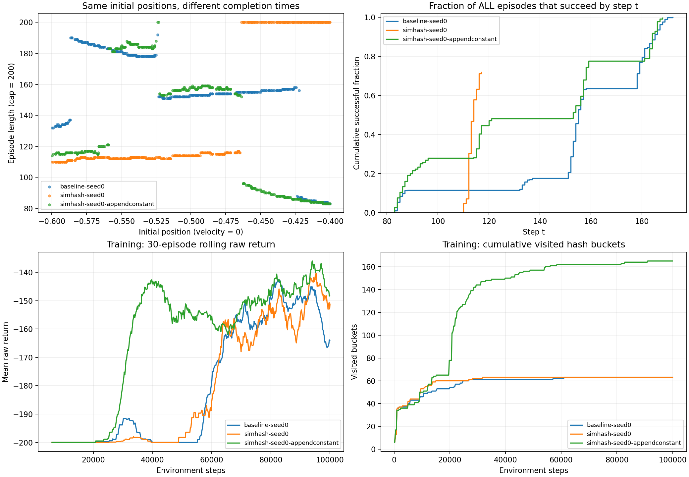
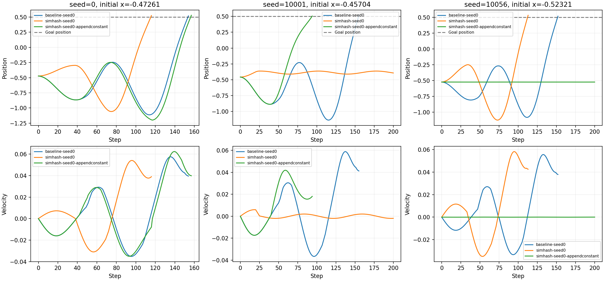
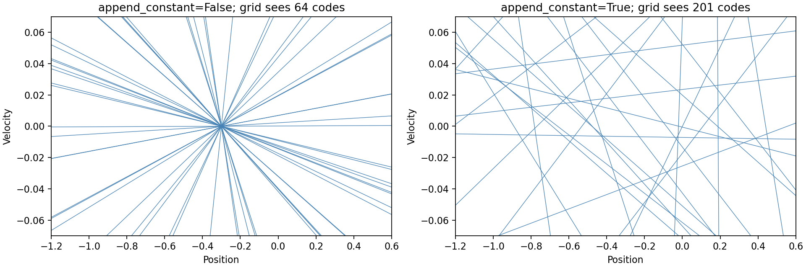

# 三组 seed0 模型的评估诊断（2026-10-31）

本次复现了原来的 500 回合评估，并额外换了 500 个初始状态。
三组模型、原训练日志和 checkpoint 均保留，没有重新训练这三组模型。
结论只针对这三个已经训练好的 checkpoint，不代表算法在多个训练 seed 上的平均表现。

## 1. 先核对分数含义

本环境每步奖励为 -1，包括成功的最后一步。逐回合数据已验证：

```text
原始回报 = -回合步数
```

所以 -135 高于 -155，意味着平均交互步数更少。
成功率表示是否在时间限制内到达目标；它不包含“成功时花了多久”。
本次所有失败回合都是 200 步截断，回报 -200。
成功与失败不应只由回报是否等于 -200 判断：理论上也可能恰好第 200 步成功，
因此脚本始终使用环境的 terminated 信号计算成功率。

## 2. 原截图结果已完整复现

三组均为 100000 训练步、训练 seed0、同一 residual Q 网络。
baseline 的 beta=0；两个 SimHash 组的 beta=0.1；其余保存的训练超参数相同。
每个 checkpoint 都用相同的 10000–10499 评估 seed，初始状态逐回合完全一致。

| 模型 | 成功数/500 | 成功率 | 全部回合平均回报 | 仅成功回合平均步数 | 失败回合平均步数 |
| --- | --- | --- | --- | --- | --- |
| baseline | 500 | 100.0% | -155.052 | 155.052 | 无失败 |
| SimHash，不追加常数 | 359 | 71.8% | -137.592 | 113.081 | 200 |
| SimHash，追加常数 | 498 | 99.6% | -135.470 | 135.211 | 200 |

截图中，追加常数这一组的平均回报也略高于不追加常数组：-135.470 > -137.592。
不追加常数组则是相对 baseline 出现“成功率更低、平均回报更高”。

算式直接揭示了原因：

```text
不追加常数：0.718 × (-113.081) + 0.282 × (-200) = -137.592
追加常数：  0.996 × (-135.211) + 0.004 × (-200) = -135.470
baseline：  1.000 × (-155.052)                         = -155.052
```

不追加常数组能成功的回合明显更快，足以抵消一部分失败回合带来的分数损失。
失败在评估中只计到第 200 步，并没有额外的巨大惩罚；因此平均回报并不保证
优先选出成功率最高的策略。若应用更在意可靠到达目标，应优先看成功率，
再在成功率相近的模型间比较完成时间。

成功回合均值还有“挑选子集”的问题。为此比较两个模型在同一初始状态上的表现：

| 同一批评估起点的分类 | 数量 | 不追加常数平均步数 | 追加常数平均步数 |
| --- | --- | --- | --- |
| 两组都成功 | 357 | 113.081 | 153.835 |
| 只有追加常数组成功 | 141 | 200（失败） | 88.057 |
| 只有不追加常数组成功 | 2 | 113 | 200（失败） |

因此也不能笼统说“加常数让每个回合都变快”：这两个最终策略擅长的起点不同。
在共同成功的 357 个起点上，不追加常数确实更快；而另外 141 个起点上，
追加常数组能够很快解决，不追加常数组失败，最终使总体均值接近。



左上图横轴是初始位置，纵轴是回合长度；橙色在右侧集中于 200 步。
右上图纵轴是“全部回合中截至 t 步已成功的比例”，终点就是成功率，
不是只在成功回合内部计算的累积分布。

## 3. 失败是具体的控制行为，不是评估时 hash 随机失效

评估完全不调用 SimHashCounter，也不添加 bonus。模型只接收原始二维状态，
通过 Q 值 argmax 决定动作。append_constant 影响的是训练期间的奖励与数据分布，
从而影响最后学到的策略；不是评估时多给 Q 网络一个输入。

不追加常数组在这 500 个起点中的失败初始位置范围是
[-0.463641, -0.400047]。这描述的是采样到的失败范围，不能仅据此证明整个连续区间
里的每个点都失败。

具体例子见下图和 [逐步轨迹 CSV](eval-seed10000/example_trajectories.csv)：

- seed0，初始位置约 -0.472608：三组都成功，分别用 154、116、157 步。
- seed10001，初始位置约 -0.457039：不追加常数组 200 步失败，其中 195 步选择向右、5 步不施力、0 步向左。它始终在约 -0.457 到 -0.362 附近活动，没有积累足够摆动到达目标；baseline 用 155 步，追加常数组用 94 步成功。
- seed10056，初始位置约 -0.523213：追加常数组 200 步全部选择不施力，停在谷底附近，最终超时。这也解释了为什么它仍然不是 100%。



这些是有意挑选的说明性样例；总体表现以全部 500 回合数据为准。
样例同时使用单样本前向复核，长度和终止结果与批量评估一致。

## 4. 发现并修复：每回合重复设 seed

检查时的 train.py 在回合结束后调用：

```python
obs, _ = env.reset(seed=config.seed)
```

在 seed0 下，这会反复把车放到约 [-0.472608, 0]。
epsilon 探索仍会产生不同轨迹，因此并不是完全重复同一条训练数据，
但训练初始状态的多样性被明显限制。

已改为：

```python
# 第一次：设置随机数发生器的起点
obs, _ = env.reset(seed=config.seed)
# 后续每次回合结束：让随机数发生器继续前进
obs, _ = env.reset()
```

这样既能使用可重复的随机序列，又能让后续回合获得不同的初始位置。
修复只影响之后的新训练，不会改变本报告中的已有模型。
已有 checkpoint 没有保存当时的源码快照，因此“当时是否就是当前这份 reset 实现”
无法仅凭 checkpoint 再独立证明；应结合实际运行时使用的代码理解。

这是一个合理的泛化风险来源，但还不能说它单独造成了三组差异。
需要在修复后、相同预算、多个训练 seed 下重新比较，才能进一步判断。

## 5. 加常数实际改变了什么

两种 hash 在状态空间中的分界线如下。未追加常数时，所有线经过缩放原点
（原坐标的 position=-0.3, velocity=0），同方向状态共享哈希。
追加常数后，分界线可离开这个点，能把沿同一方向的状态进一步分开。



在 241×241 的观测空间网格上分别观察到 64、201 个不同编码；
实际训练日志中访问过的桶分别为 63、165 个。
网格结果受采样分辨率影响，不能当作精确的连续空间分区总数。
两种 hash 的分桶规则不同，因此“访问桶更多”也不能直接解释为探索面积更大。

训练日志还显示：

| 指标 | baseline | 不追加常数 | 追加常数 |
| --- | --- | --- | --- |
| 首个成功回合结束步数 | 20791 | 25397 | 20785 |
| 最后 50 个训练回合成功率 | 98% | 96% | 100% |
| 最后 50 个训练回合原始平均回报 | -157.10 | -145.94 | -142.48 |
| 全部已完成回合平均 beta×bonus / 步 | 0 | 0.003332 | 0.005837 |

相同 beta 不代表相同的实际奖励强度：分桶更多时，次数和 bonus 的衰减也会改变。
上表只能描述这次 run；首次成功时间并不能单独证明探索效率优劣。

另一个对照细节：当前实现用同一随机 seed 分别生成 [32,2] 与 [32,3] 矩阵，
第三列的加入也改变了每一行从随机序列取数的位置，因此两组的前两列并非完全相同。
本次比较的是两个完整 hash 配置，不是“保持同一组二维法向量、只加偏置”的严格对照。

目前能确认：追加常数改变分桶，这个 checkpoint 对大部分评估起点更可靠。
尚不能确认：追加常数本身保证可靠，或者桶数更多必然导致更好的策略。

## 6. 新增 500 个评估起点的复核

仍使用原来的三个 checkpoint，评估 seed 换成 20000–20499：

| 模型 | 成功率 | 平均回报 | 仅成功回合平均步数 |
| --- | --- | --- | --- |
| baseline | 100.0% | -153.888 | 153.888 |
| 不追加常数 | 69.0% | -140.016 | 113.067 |
| 追加常数 | 99.8% | -133.592 | 133.459 |

现象与原评估一致。但这是增加评估起点，不是增加训练重复次数。
同一个策略反复评估 1000 回合，也不能代替用多个 seed 从头训练。

## 7. 分析脚本与下一步

[analyze.py](../analyze.py) 可独立运行，默认比较这三组 checkpoint。
它记录各回合的初始位置、成功与否、长度、原始回报、最大位置和最小 Q 动作间隔，
并保存配置、版本、checkpoint SHA256、配对统计和图像。
输出目录要求不存在，以免覆盖之前的数据。

本地依赖环境中，从本目录运行：

```powershell
python analyze.py --episodes 500 --seed 10000 --output-dir analysis/my-eval10000
python analyze.py --episodes 500 --seed 20000 --output-dir analysis/my-eval20000
```

或从仓库根目录运行：

```powershell
docker compose run --rm -w /workspace/mountaincar-dqn-count/SimHash runner python analyze.py --episodes 500 --seed 10000 --output-dir analysis/my-eval10000
```

本次保存的数据：

- [原评估的逐回合数据与图像](eval-seed10000/summary.json)
- [新增评估的逐回合数据与图像](eval-seed20000/summary.json)

本机分析环境为 Python 3.11.13、PyTorch 2.9.0+cu128、NumPy 2.2.6、Gymnasium 1.2.0，
在 CPU 上单线程批量前向。与仓库 Docker 锁定版本存在差别，但原 500 回合的三项
总体结果均精确复现到截图所示精度；具体版本和 checkpoint 哈希已保存在 JSON 中。

已完成验证：原 model/hash/replay/dqn 自检全部通过；分析脚本成功完成两组各 500 回合的三模型评估；
新增轨迹样例完成单样本推理核对；修复后的训练跑通 2500 步，覆盖 warmup 后更新和 target 同步，
并在运行时断言只有首次 reset 传入 seed0、后续 reset 均不重设 seed。
2500 步仅为流程验证，不是新的完整训练对照。

后续已完成：使用修复后的 reset，三种配置各跑 seed0/1/2，每次 100000 步；
另外补做三种配置的固定起点 seed0 配对重训，共 12 次 GPU 训练。
固定起点重训的日志与模型权重完整复现旧实验。
完整结果、seed 波动和 reset 的配对影响见 [下一轮训练对照报告](reset-generalization-20261031/REPORT.md)。
如果再严格分离“分区几何”和“bonus 强度”的贡献，还需做匹配法向量与奖励尺度的对照。
