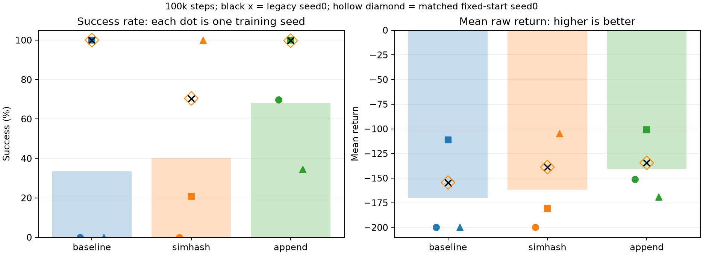
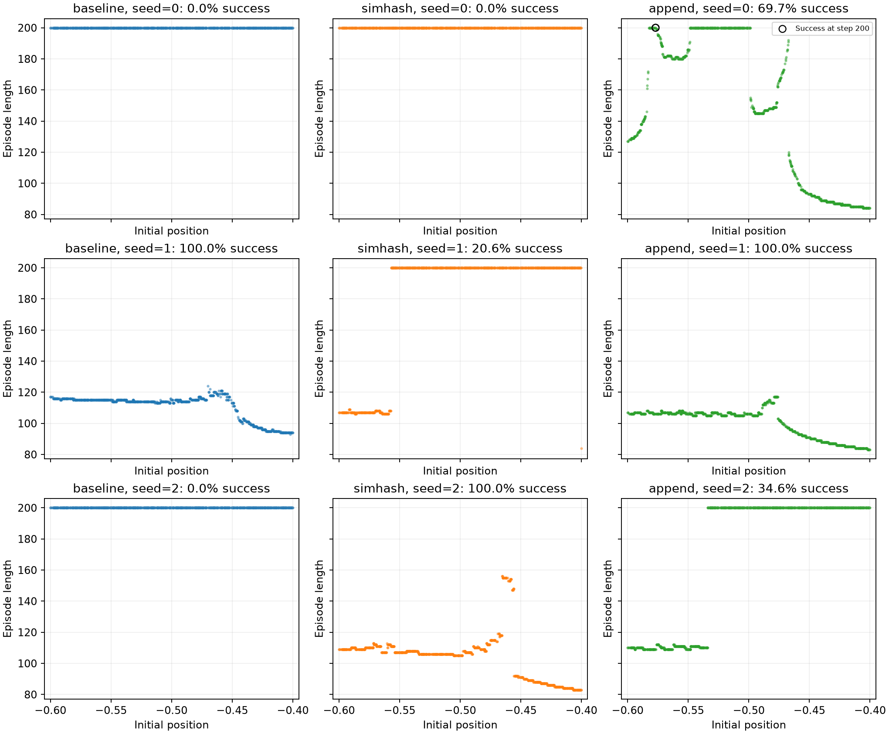
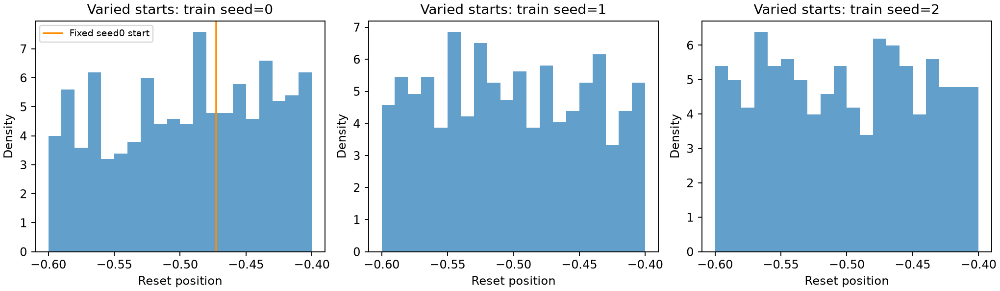
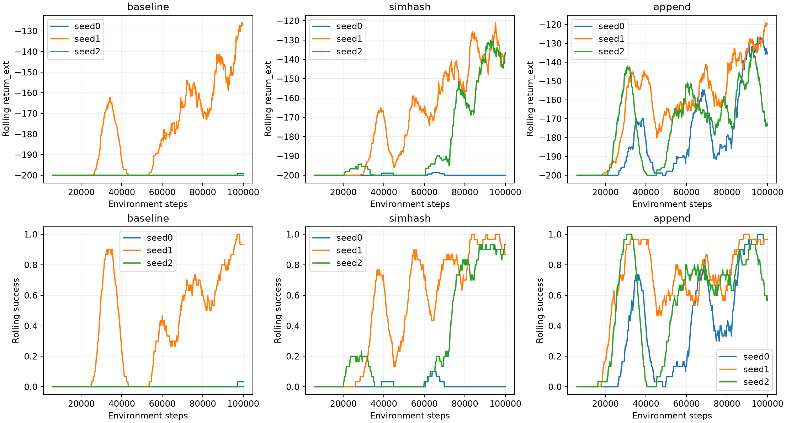

# Reset、SimHash 与训练 seed 的对照（2026-10-31）

已完成 12 次正式 GPU 训练：9 次随机起点主实验，以及 3 次固定起点 seed0 配对重训。
每次 100000 环境步，共 1200000 步；没有调整网络、学习率、epsilon 或奖励系数。
另有三个 GPU 短跑仅用于流程检查，不计入正式结果。

最重要的结果是：**三个固定起点重训模型完整复现了旧实验，训练日志一致，
保存的 Q 网络参数与 buffer 逐元素相同，最大差值为 0。**
在同一环境和 seed0 下，仅改变每回合 reset 的方式，就足以改变最终表现。
而变化的方向是：放开起点后，同样 10 万步预算下的 seed0 表现下降。
修复 reset 让训练符合默认起点分布，并不保证原来的超参数和预算立即得到更好模型。

## 1. 本轮具体做了什么

主实验使用首次 `env.reset(seed=seed)`，之后 `env.reset()`，三种配置各训练 seed0/1/2：

| 配置名 | beta | append_constant | 训练步数/seed |
| --- | --- | --- | --- |
| baseline | 0 | false | 100000 |
| simhash | 0.1 | false | 100000 |
| append | 0.1 | true | 100000 |

随后补充三种配置的固定起点 seed0 对照：使用相同的冻结训练源码和超参数，
只通过环境 wrapper 在每次 reset 时强制传入 seed0，重现旧代码的行为。
这个 wrapper 记录实际生效的 seed，不改变奖励、动作、环境动力学或训练公式。
当前项目的 train.py 仍保留正确的首次设 seed、之后继续 RNG 的实现。

所有 12 个新 checkpoint 和 3 个旧 checkpoint 在同一 Docker 环境中评估。
每个使用相同的 1000 个评估起点：seed10000–10499、seed20000–20499。
评估使用贪心动作、不加 bonus、不更新 hash 次数，统计原始奖励和 terminated。
合计保存 15000 个评估回合；每个回合都核对了回报等于负的回合步数。

环境为 RTX 4090 Laptop GPU、Python 3.11.14、PyTorch 2.9.1+cu128、
Gymnasium 1.2.2、NumPy 2.4.6。训练强制 CUDA，最多三个独立 worker 并发；
评估在该容器的 CPU 上单线程批量前向。未启用 torch.compile 或强制确定性算法。
主实验于北京时间约 19:40 开始，固定起点对照于约 20:18 完成，随后完成统一评估。

## 2. Reset 的影响：seed0 配对结果

以下固定起点结果来自本轮重新训练，不只是引用旧模型：

| 配置 | 固定起点成功率 | 随机起点成功率 | 固定起点平均回报 | 随机起点平均回报 |
| --- | --- | --- | --- | --- |
| baseline | 100.0% | 0.0% | -154.470 | -200.000 |
| simhash | 70.4% | 0.0% | -138.804 | -200.000 |
| append | 99.7% | 69.7% | -134.531 | -151.288 |

两边 checkpoint 的评估初始状态完全一致。seed0 的配对比较中：

- baseline：固定起点模型在 1000 个评估起点都成功，随机起点模型都失败。
- simhash：固定起点模型成功的 704 个起点，随机起点模型都失败。
- append：两者共同成功 697 回合，另外 300 回合只有固定起点模型成功。

完整复现的证据保存在 [summary.json](summary.json) 的 `fixed_vs_legacy_weights`：

| 固定起点重训与旧实验对比 | 全部已完成回合日志相同 | Q 参数与 buffer 逐元素相同 | 最大绝对差值 |
| --- | --- | --- | --- |
| baseline | 是 | 是 | 0 |
| simhash | 是 | 是 | 0 |
| append | 是 | 是 | 0 |

这比“新模型碰巧比旧模型差”更有说服力：固定起点实现可以完整复现旧实验；
同一训练 seed、同一份算法代码下，只改变 reset 后，模型发生了上述变化。
这个配对结论限定在 seed0。固定起点组没有补做 seed1/2，不能据此声称
随机起点训练对所有训练 seed 都更差。

## 3. 为什么改正确了，分数反而可能下降

固定起点把训练限制为反复从约 `[-0.472608, 0]` 出发。
同一个出发状态下，探索成功的轨迹和经验可能更容易再次利用；
换成整个初始分布后，训练访问的状态与经验分布随之改变，原来的预算不一定够用。
这是对数据的解释，不能仅凭这些实验进一步证明具体的梯度或优化机制。

首次成功的时间给出了直接证据：

| 配置（seed0） | 固定起点首次成功回合结束步数 | 随机起点首次成功回合结束步数 | 随机起点训练成功回合总数 |
| --- | --- | --- | --- |
| baseline | 20791 | 97175 | 1 |
| simhash | 25397 | 38968 | 4 |
| append | 20785 | 26387 | 237 |

例如随机起点 baseline-seed0 到第 97175 步才首次成功，离训练结束已经很近。
baseline-seed2 则在完整预算里一次都没有成功。它们缺少成功终止的训练样本，
最终评估失败就不再是难以解释的现象。仅凭这些数据，仍不能断言增加预算就一定能解决。

固定起点也不等于模型一定只会这个起点：旧 baseline-seed0 对另外 1000 个
评估起点仍然全部成功。训练分布受到限制与最终泛化好坏，需要分别测量。

## 4. 三个训练 seed 的完整主实验

下面全部使用正确的随机起点训练。每行是一个独立训练的最终 checkpoint。

| 配置 | 训练 seed | 成功率 | 全部回合平均回报 | 仅成功回合平均步数 |
| --- | --- | --- | --- | --- |
| baseline | 0 | 0.0% | -200.000 | — |
| baseline | 1 | 100.0% | -111.073 | 111.073 |
| baseline | 2 | 0.0% | -200.000 | — |
| simhash | 0 | 0.0% | -200.000 | — |
| simhash | 1 | 20.6% | -180.828 | 106.932 |
| simhash | 2 | 100.0% | -104.784 | 104.784 |
| append | 0 | 69.7% | -151.288 | 130.112 |
| append | 1 | 100.0% | -100.875 | 100.875 |
| append | 2 | 34.6% | -168.883 | 110.066 |

各配置先计算每个训练 seed 的结果，再对三个 seed 求均值与样本标准差：

| 配置 | 成功率均值 | seed 间成功率标准差（百分点） | 平均回报均值 ± 标准差 |
| --- | --- | --- | --- |
| baseline | 33.3% | 57.7 | -170.358 ± 51.342 |
| simhash | 40.2% | 52.8 | -161.871 ± 50.359 |
| append | 68.1% | 32.7 | -140.349 ± 35.299 |

标准差描述三个训练 seed 之间的波动，不是置信区间。
本轮 append 的均值最好、波动相对较小，但仍从 34.6% 到 100%，不能称为稳定解决。
seed2 上普通 SimHash 明显优于 append，说明“加常数每次都更好”不成立。
三个训练重复也不足以给出普遍或显著性排序。

成功回合平均步数没有对全失败模型填 0。`by_variant.csv` 记录了每项指标的
`valid_runs`：例如 baseline 只有一个训练模型存在成功回合，不能把它的
111.073 步误解为三个模型都能达到的完成速度。

图中圆点/方块/三角分别表示 seed0/1/2；柱高是随机起点三次训练的均值。
黑色叉号是旧模型，橙色空心菱形是本轮固定起点重训，两者完全重合。

## 5. 失败是否集中在特定初始状态

每行一个训练 seed，每列一种配置；200 步的水平点列大部分是本次超时失败。
但 append-seed0 有两个评估回合（seed10033、seed20429）恰好在第 200 步到达目标，
terminated 和 truncated 同时为 True，回报仍是 -200。图中用黑色空心圆标记它们。
这两个回合已正确计入成功率，说明不能只用回报等于 -200 或长度等于 200 判断失败。

例如 append-seed2 在采样到的约 -0.534 到 -0.400 的一段起点上失败很多，
而 simhash-seed2 在这批评估起点上全部成功。append-seed0 的失败区域则不同。
这表明不同训练 seed 学到的策略覆盖范围也不同，不能只比较一个汇总平均数。
图中的采样范围不是对每个连续初始位置的严格证明。

## 6. 已核实 reset 修复实际生效

每次 reset 的参数与观测都保存在对应训练目录的 `resets.csv`。
九次主实验均通过运行时断言：首次传入各自 seed，之后不再传 seed。
固定起点对照则每次实际使用 seed0。

| seed0 配置 | 固定起点的不同初始位置数 | 随机起点的不同初始位置数 | 随机起点位置范围 |
| --- | --- | --- | --- |
| baseline | 1 | 501 | [-0.599940, -0.400558] |
| simhash | 1 | 501 | [-0.599940, -0.400558] |
| append | 1 | 567 | [-0.599940, -0.400100] |

append-seed0 实际 reset 568 次，其中两个 float32 初始位置碰巧相同，所以不同位置数为 567。
reset 次数包括尚未完成的最后一回合；不能直接等同于已完成回合数。
同一个训练 seed 下，三种配置的起点序列在共同长度内完全一致，
只因回合长度不同，最终消耗的起点数量不同。

这里的分布图使用各 seed 的 baseline 起点日志；seed0 的橙线是固定起点位置。

哈希还有一个与课程内容直接相关的观察：随机起点的原始位置都在 [-0.6,-0.4]，
初速度为 0。缩放后都在负的横轴上，纯 SimHash 将这些 reset 观测映射到同一个桶。
追加常数后三个 seed 的 reset 观测分别落入 5、2、2 个不同桶。
这不表示纯 SimHash 的 Q 网络不能区分这些位置：Q 网络仍接收原始二维状态。
而且教程没有给 reset 观测直接加访问次数，这个统计只是检查分区几何。

## 7. 训练成功率不能代替最终独立评估

上排是原始训练回报，下排是训练成功率，均用 30 个回合滑动平均。
训练动作包含 epsilon 探索，参数也在不断更新；它与固定最终参数、epsilon=0 的
独立评估不是同一种测量。

例如 simhash-seed1 最后 50 个训练回合成功率 92%，最终贪心评估却只有 20.6%；
append-seed0 对应为 98% 与 69.7%。因此不能只根据训练日志宣布模型解决了任务。
本轮未保存中间 checkpoint 的独立评估，无法判断这些差距分别有多少来自
探索动作的作用、最后一段参数变化或其他因素，不能直接归因于某一种“遗忘”机制。

同样 beta 也不等于相同 bonus 强度。三个 seed 的平均 `beta×bonus/步` 分别为：

| 配置 | seed0 | seed1 | seed2 |
| --- | --- | --- | --- |
| simhash | 0.003141 | 0.004169 | 0.003749 |
| append | 0.005152 | 0.005624 | 0.004444 |

append 同时改变了分区与奖励衰减；本轮没有单独隔离这两个贡献。
训练 seed 还同时影响网络初始化、探索动作、回放采样、环境起点与随机投影。
所以 seed 间波动描述的是整条训练流程，不是单独某一个组件的随机性。

## 8. 文件、复现与检查

完整命令与目录说明见 [experiments/README.md](../../experiments/README.md)。
旧模型和旧分析均保留，没有覆盖或移动。

- [summary.json](summary.json)：完整来源、版本、哈希、配对结果、起点审计和权重复现检查。
- [per_run.csv](per_run.csv)：12 个新模型和 3 个旧模型的单独结果。
- [by_variant.csv](by_variant.csv)：九次主训练按配置汇总的均值与标准差。
- [per_episode.csv](per_episode.csv)：15000 个评估回合，所有模型的评估 seed 和初始位置已逐一核对一致。
- [analysis_driver.py](analysis_driver.py)：实际执行的分析脚本副本，其 SHA256 在 summary.json 中。
- [plot_refinement.py](plot_refinement.py)：仅从已保存 CSV 重画起点图、改善刻度可读性的脚本，哈希也已记录。
- [训练目录](../../runs/reset-generalization-20261031/)：冻结学习源码、调度 manifest、终端日志、起点、配置、完成元数据和 checkpoint。
- [补充固定起点对照](../../runs/reset-generalization-20261031/fixed-controls/)：wrapper 代码快照与三次配对训练。

所有冻结学习源码哈希检查通过，worker 及其运行时 helper 的 AST 与冻结版本一致。
12 次正式训练均完成 CUDA 检查与 reset 断言；同一 Docker 环境中的四项课程自检全部通过。
保存的旧 checkpoint SHA256 与本轮开始时一致。

本轮可以确认 reset 的 seed0 配对影响，以及这份配置在三个随机起点训练 seed 上的明显波动。
下一步最有价值的是增加固定间隔 checkpoint 和独立验证评估，区分“还没学会”与“最终策略退化”；
再在所有配置相同的新预算下检查是否只是 10 万步不足。以上进一步训练尚未执行。
